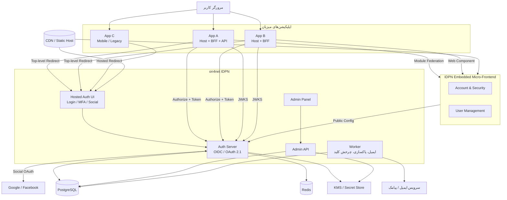
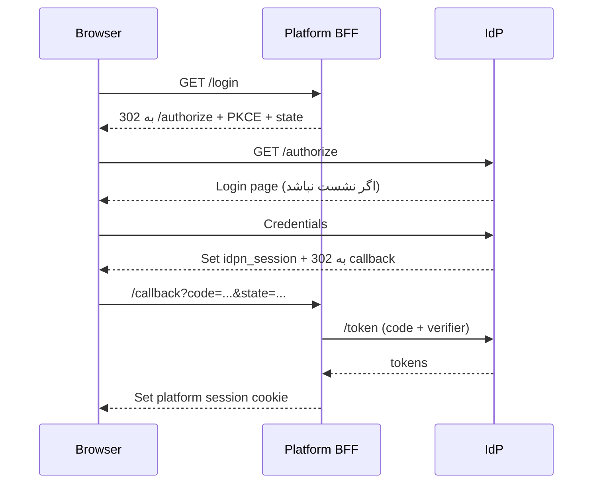
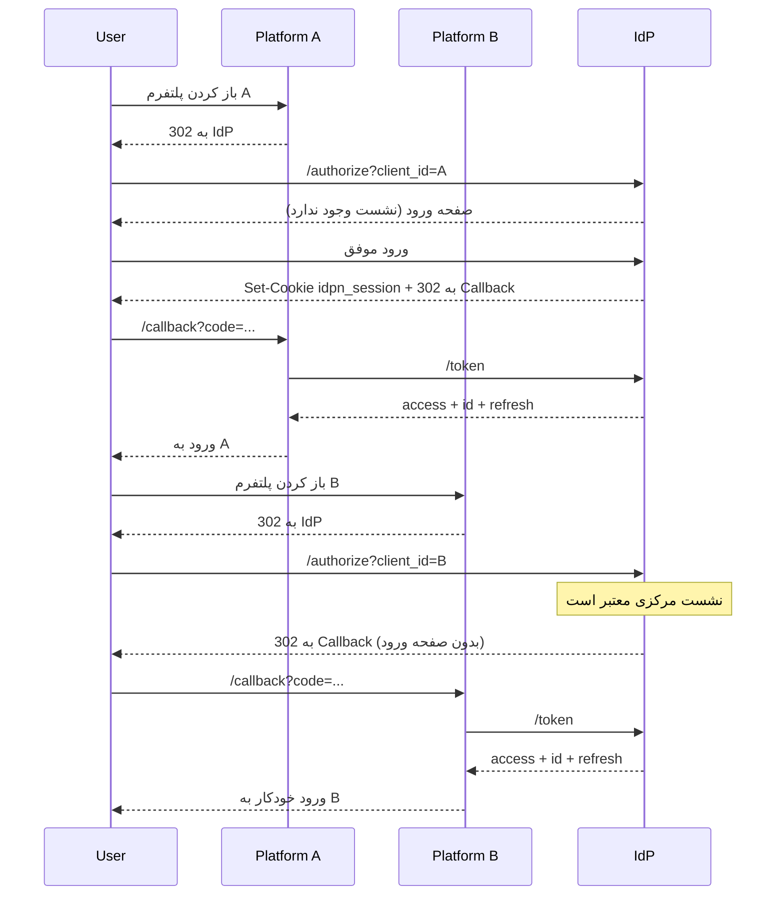

# معماری سامانه

> این سند نمای کلی اجزا، جریان SSO، استقرار و الزامات غیرعملکردی را تعریف می‌کند. جزئیات جریان‌ها در [auth-flows.md](./auth-flows.md) و مدل داده در [domain-model.md](./domain-model.md) آمده است.

## 1. نمای کلی



### اجزای اصلی

| جزء | مسئولیت | پوشه پیشنهادی |
|---|---|---|
| **Auth Server** | Endpointهای OIDC (`/authorize`، `/token`، `/userinfo`، `/jwks.json`، `/logout`)، نشست مرکزی، صدور توکن، سوشال لاگین | `api/` |
| **Hosted Auth UI** | صفحه ورود/MFA/سوشال روی دامنه `auth` با کدبیس مشترک؛ خارج از دامنه اپ‌ها | `web/` |
| **Admin API** | CRUD کاربران، کلاینت‌ها، نقش‌ها، تخصیص‌ها، عضویت‌ها، Providerهای سوشال، نشست‌ها، Audit | `api/` |
| **Admin Panel** | رابط مدیریت سراسری روی دامنه مستقل | `web/` |
| **Embedded Micro-Frontend** | ماژول‌های `account` و `user-management` برای Mount در اپ‌ها | `web/` |
| **CDN / Static Host** | انتشار نسخه‌دار Assetهای MFE/Hosted UI و `remoteEntry.js` | — |
| **Worker** | ارسال ایمیل/پیامک، پاکسازی توکن‌های منقضی، چرخش کلید، Retry خروج، هشدارهای امنیتی | `api/` |
| **PostgreSQL** | منبع حقیقت داده‌ها (کاربر، عضویت، نقش، کلاینت، Audit) | — |
| **Redis** | نشست‌ها، Rate Limit، کش کوتاه‌مدت، صف سبک | — |
| **KMS / Secret Store** | کلید خصوصی امضا، Secret کلاینت‌ها و Providerهای سوشال، کلید رمزنگاری فیلدهای حساس | — |

> Auth Server و Admin API می‌توانند در یک اپلیکیشن با ماژول‌های جدا اجرا شوند، اما **کلاینت OIDC پنل ادمین** باید مستقل از کلاینت‌های کسب‌وکار باشد و MFA اجباری داشته باشد. صفحه ورود به‌دلیل امنیت کوکی/SSO روی دامنه IdP میزبانی می‌شود و در اپ Mount نمی‌شود؛ جزئیات در [micro-frontend.md](./micro-frontend.md).

## 2. الگوی اتصال پلتفرم‌ها

هر اپلیکیشن سه لایه اتصال دارد:

1. **ورود (Hosted):** کاربر با Redirect سطح‌بالا به صفحه ورود مشترک روی دامنه `auth` می‌رود؛ این صفحه با همان کدبیس فرانت‌اند مشترک ساخته شده اما داخل اپ Mount نمی‌شود.
2. **ماژول‌های احرازشده (Embedded):** ماژول‌های `account` و `user-management` به‌صورت میکرو-فرانت‌اند (Module Federation برای React یا Web Component برای سایر فریمورک‌ها) داخل اپ نمایش داده می‌شوند. جزئیات در [micro-frontend.md](./micro-frontend.md).
3. **لایه پروتکل:** بک‌اند اپ با OIDC/OAuth 2.1 به IdP متصل می‌شود (BFF، SPA/Mobile یا M2M).

### گزینه A — BFF (توصیه‌شده برای وب)



- مرورگر فقط کوکی نشست خود پلتفرم را دارد.
- Access/Refresh Token روی سرور پلتفرم نگهداری می‌شود.
- هیچ توکنی در `localStorage` یا جاوااسکریپت قابل دسترس نیست.

### گزینه B — SPA / موبایل با PKCE

- کلاینت عمومی است و **Refresh Token در حافظه یا Secure Storage** نگهداری می‌شود.
- برای SPA، Refresh Token در حافظه و در صورت نیاز Silent Renew با `prompt=none`.
- برای موبایل، از Keychain/Keystore استفاده شود.
- استفاده از Refresh Token در `localStorage` ممنوع است.

### گزینه C — Machine-to-Machine

- سرویس‌ها با `client_credentials` توکن می‌گیرند.
- این کلاینت‌ها کاربر ندارند و نقش‌ها به‌صورت مستقیم به سرویس تخصیص می‌یابد.

### الگوی سوشال لاگین (Per-Client)

- هر کلاینت می‌تواند Google/Facebook را با **Client ID/Secret اختصاصی خودش** فعال کند.
- Secret در `ClientSocialProvider` رمزنگاری‌شده ذخیره می‌شود و هرگز به مرورگر یا اپ نمی‌رسد.
- صفحه ورود بر اساس `client_id` فقط Providerهای فعال همان اپ را نشان می‌دهد.
- Callback اختصاصی: `/oauth2/social/{clientId}/{provider}/callback` (باید در کنسول Provider همان اپ ثبت شود).
- جریان کامل در [auth-flows.md](./auth-flows.md#9-ورود-اجتماعی-social-login).

## 3. جریان SSO بین پلتفرم‌ها



نکات کلیدی:

1. SSO بر پایه **کوکی نشست روی دامنه IdP** است، نه اشتراک کوکی بین پلتفرم‌ها.
2. پلتفرم‌ها می‌توانند زیردامنه یا دامنه کاملاً متفاوت باشند؛ جریان با Redirect سطح‌بالا کار می‌کند.
3. کوکی IdP نباید روی دامنه والد (`.on4net.ir`) تنظیم شود مگر اینکه همه زیردامنه‌ها کاملاً مورد اعتماد باشند. پیشنهاد: فقط `auth.<domain>`.
4. محدودیت کوکی‌های Third-Party در مرورگرها روی این جریان اثر ندارد، چون Redirect سطح‌بالا است.
5. برای تشخیص «نشست معتبر است» از `prompt=none` استفاده می‌شود؛ اگر نشست نباشد خطای `login_required` برمی‌گردد و پلتفرم می‌تواند کاربر را به ورود هدایت کند.
6. پارامتر `max_age` برای اجبار به احراز هویت مجدد (مثلاً عملیات حساس) استفاده می‌شود.
7. `sid` در ID Token و Access Token، نشست مرکزی را به نشست پلتفرم متصل می‌کند و مبنای Back-channel Logout است.

## 4. چرا IdP مرکزی و نه اشتراک توکن بین پلتفرم‌ها؟

- پلتفرم‌ها به‌مرور زمان تغییر می‌کنند؛ قرارداد OIDC پایدار است.
- ابطال دسترسی در یک نقطه انجام می‌شود.
- نقش‌ها و مجوزها یک منبع حقیقت دارند.
- امکان افزودن MFA، ورود اجتماعی و حسابرسی بدون تغییر هر پلتفرم.
- جداسازی دامنه امنیتی: افشای یک پلتفرم به‌معنای افشای رمز همه پلتفرم‌ها نیست.

## 5. استقرار

### محیط توسعه

- Docker Compose شامل PostgreSQL، Redis، Mailhog (ایمیل آزمایشی) و اپلیکیشن.
- کلیدهای امضا به‌صورت محلی تولید و در فایل موقت نگهداری می‌شوند (هرگز Commit نشوند).
- HTTPS محلی با گواهی self-signed یا mkcert؛ در حالت توسعه، `http://localhost` برای Redirect URI مجاز است.

### محیط تولید

```
Internet
   │
   ▼
Reverse Proxy / WAF (TLS termination)
   │
   ├── auth.example.com      → Auth Server (2+ replica)
   ├── admin.example.com     → Admin Panel + Admin API
   ├── api.example.com       → Admin API / UserInfo (در صورت جداسازی)
   └── cdn.example.com       → MFE Remoteها (نسخه‌دار، Immutable)
        │
        ├── PostgreSQL (Primary + Replica، Backup روزانه + WAL)
        ├── Redis (HA / Sentinel یا Managed)
        ├── Object Storage / CDN (Assetهای MFE + Manifest)
        └── KMS / Vault
```

- Auth Server **Stateless** است؛ نشست و Rate Limit در Redis نگهداری می‌شود.
- حداقل دو replica برای حذف تک‌نقطه‌خطا.
- MFE روی CDN با نسخه Immutable منتشر می‌شود و Hostها می‌توانند بدون Deploy مجدد نسخه را ارتقا دهند.
- کلید خصوصی امضا در KMS/Vault یا فایل رمزنگاری‌شده با دسترسی محدود؛ هرگز در تصویر Docker یا مخزن کد نباشد.
- Secretهای Providerهای سوشال هر کلاینت جداگانه رمزنگاری می‌شوند.
- چرخش کلید هر 90 روز با انتشار هم‌زمان کلید جدید در JWKS و نگهداری کلید قبلی تا انقضای توکن‌ها.
- Backup رمزنگاری‌شده، تست بازیابی دوره‌ای، RPO ≤ 15 دقیقه، RTO ≤ 1 ساعت.

### پیکربندی محیطی

| متغیر | نمونه | توضیح |
|---|---|---|
| `APP_URL` | `https://auth.example.com` | Issuer و Base URL |
| `ADMIN_URL` | `https://admin.example.com` | آدرس پنل |
| `DATABASE_URL` | `postgres://...` | اتصال PostgreSQL |
| `REDIS_URL` | `redis://...` | اتصال Redis |
| `SESSION_SECRET` | تصادفی 32 بایت | امضای کوکی/CSRF |
| `SIGNING_KEY_REF` | `vault://...` | مرجع کلید امضا |
| `MFE_PUBLIC_URL` | `https://cdn.example.com/idpn-mfe` | آدرس پایه Remoteها و Manifest |
| `MFE_ALLOWED_ORIGINS` | دامنه‌های Host | Originهای مجاز برای CORS/PostMessage |
| `SOCIAL_CALLBACK_BASE_URL` | `https://auth.example.com` | پایه Callback سوشال |
| `SMTP_URL` | `smtp://...` | ارسال ایمیل |
| `SMS_PROVIDER_*` | — | ارسال پیامک (در صورت نیاز) |
| `TRUSTED_PROXY_CIDRS` | `10.0.0.0/8` | استخراج IP واقعی |
| `LOG_LEVEL` | `info` | سطح لاگ |

## 6. الزامات غیرعملکردی (پیشنهادی)

| موضوع | هدف | توضیح |
|---|---|---|
| دسترس‌پذیری | 99.9% ماهانه | Auth Server حیاتی است؛ بدون آن ورود پلتفرم‌ها ممکن نیست |
| تأخیر صدور توکن | p95 < 300ms | بدون احتساب شبکه |
| تأخیر صفحه ورود | p95 < 800ms | شامل رندر |
| مقیاس | 100k کاربر، 50 login/s اولیه | با امکان افقی‌شدن |
| نگهداشت Audit | 12 ماه (حداقل) | قابل تنظیم و Export |
| RPO / RTO | 15 دقیقه / 1 ساعت | بکاپ و بازیابی |
| سازگاری | OIDC Core 1.0 | تأیید با Conformance Suite در فاز 6 |

> اعداد بالا فرضی هستند و پس از دریافت حجم واقعی (پرسش 11 در [README](./README.md)) به‌روزرسانی می‌شوند.

## 7. استک (تأییدشده)

| لایه | انتخاب | توضیح |
|---|---|---|
| Backend | Node.js LTS + TypeScript + NestJS | ساختار ماژولار؛ Adapter: `@nestjs/platform-fastify` |
| Database | PostgreSQL 16 | الزام کارفرما |
| ORM/Migration | Prisma (پیشنهادی) | Migration و Type Safety؛ جایگزین: Drizzle |
| Cache/Session | Redis 7 | نشست، Rate Limit، Cache |
| Auth/JWT | `jose` | امضا و اعتبارسنجی ES256/JWKS |
| Social OAuth | `arctic` | Google/Facebook با Credential هر کلاینت |
| Admin Panel | React 19 + Vite + TypeScript + shadcn/ui | مستقل روی دامنه `admin` |
| Micro-Frontend | React 19 + Vite + Module Federation + shadcn/ui | Remote برای Hostهای React |
| Packaging غیر-React | Web Component (Custom Element + Shadow DOM) | سازگاری با Vue/Angular/Legacy |
| UI/Styling | shadcn/ui + Tailwind CSS v4 + توکن‌های OKLCH | ایزولاسیون با Scope/Shadow DOM؛ جزئیات در [design-system.md](./design-system.md) |
| State/Data | TanStack Query + React Context | بدون وابستگی به Store میزبان |
| Forms/Validation | React Hook Form + Zod | اعتبارسنجی مشترک |
| i18n | i18next + RTL | فارسی/انگلیسی |
| Unit/Integration | Vitest + Supertest + Testcontainers | Postgres/Redis واقعی |
| E2E | Playwright | سناریوهای چنداپلیکیشنی |
| Load | k6 | تست ظرفیت |
| Observability | OpenTelemetry + Prometheus + Grafana + Loki | Log/Metric/Trace |
| Deployment | Docker Compose (شروع) → Kubernetes (در صورت نیاز) | CDN برای MFE |

**دلیل انتخاب:** Node.js و PostgreSQL الزام کارفرما هستند. NestJS با Adapter Fastify ساختار Guard/Module برای RBAC و Audit می‌دهد و در عین حال عملکرد HTTP بهتری دارد. React 19 + Vite + shadcn/ui به‌دلیل سرعت توسعه، Accessibility و پشتیبانی Module Federation انتخاب شده و خروجی Web Component تضمین می‌کند اپ‌های غیر-React هم بدون بازبینی از همان UI استفاده کنند.

## 8. مرزهای اعتماد

| مرز | اعتماد | کنترل |
|---|---|---|
| مرورگر کاربر | نامعتبر | Cookie امن، CSRF، CSP، عدم ذخیره توکن |
| پلتفرم‌ها (کلاینت) | نیمه‌معتمد | Redirect URI دقیق، Client Secret، Scope محدود |
| MFE Remote / CDN | کد اجرایی | Origin Allowlist، نسخه Immutable، CSP، بازبینی Supply Chain |
| Admin Panel | بسیار حساس | MFA اجباری، نشست کوتاه، Audit، IP Allowlist اختیاری |
| Delegated Admin (ادمین اپ) | محدود | Scope سروری به `clientId` خودش، بدون دسترسی به نقش سراسری/Secret |
| APIهای داخلی | معتمد برای اعتبارسنجی توکن | JWKS، بررسی `aud`/`iss`/`exp`، Deny-by-default |
| Providerهای سوشال | نامعتبر | State/Nonce، اعتبارسنجی پاسخ، Secret رمزنگاری‌شده per client |
| سرویس‌های ثالث | نامعتبر | فقط در صورت نیاز، Scope محدود و Consent |

## 9. نقاط شکست و رفتار مورد انتظار

| سناریو | رفتار |
|---|---|
| قطعی Redis | در صورت امکان Fail-open برای خواندن نشست؟ **خیر**؛ ورود جدید Fail می‌شود، اما نشست‌های فعال با خطای موقت مواجه می‌شوند. نباید احراز هویت دور زده شود. |
| قطعی PostgreSQL | Auth Server خطای 503 می‌دهد؛ صفحه ورود پیام موقت نشان می‌دهد. |
| از دست رفتن کلید امضا | چرخش اضطراری؛ کلید عمومی جدید در JWKS فوری منتشر می‌شود. توکن‌های قبلی تا انقضا معتبر می‌مانند. |
| خطای سرویس ایمیل | ثبت در صف و تلاش مجدد؛ ورود کاربر مسدود نمی‌شود مگر برای تأیید ایمیل. |
| افزایش ناگهانی ورود | Rate Limit سراسری و به‌ازای IP/حساب؛ صف و هشدار. |
| خطای بارگذاری MFE Remote | Host به صفحه Hosted روی `auth.example.com` هدایت می‌شود؛ ورود متوقف نمی‌شود. |
| قطعی CDN | نسخه پین‌شده از Cache مرورگر یا Fallback Hosted استفاده می‌شود. |
| خطای Provider سوشال | پیام قابل فهم و بازگشت به ورود رمز؛ Providerهای دیگر فعال می‌مانند. |
| از کار افتادن Credential سوشال یک اپ | فقط سوشال همان اپ غیرفعال می‌شود؛ سایر اپ‌ها و ورود رمز اثر نمی‌گیرند. |
| تلاش ادمین اپ برای دسترسی Cross-Client | پاسخ `403` و ثبت Audit؛ هیچ داده‌ای افشا نمی‌شود. |
