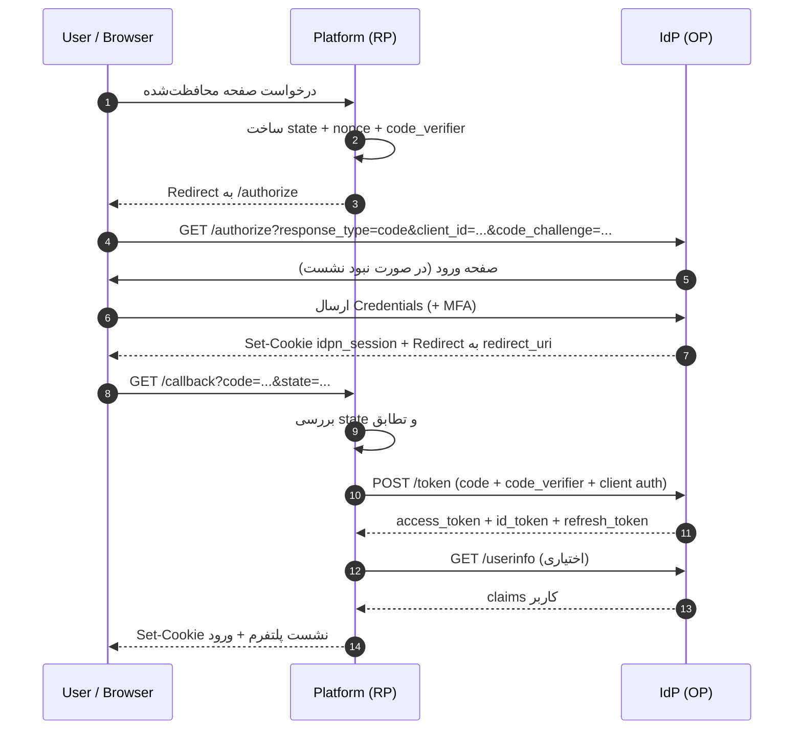
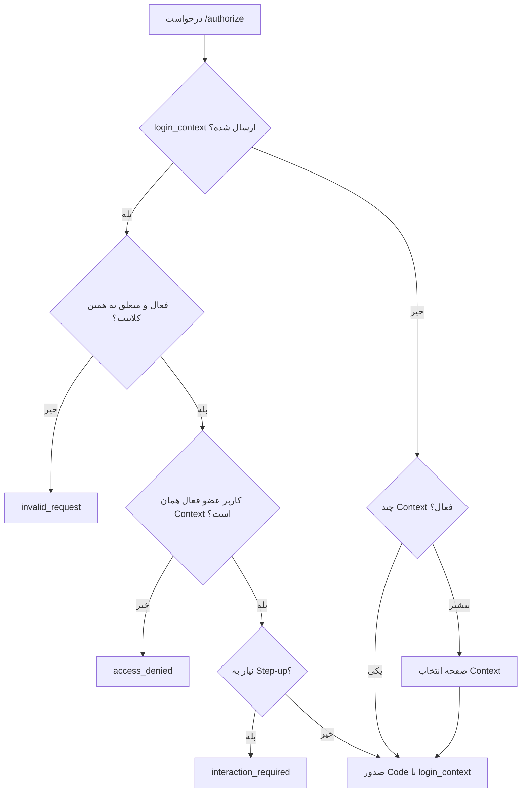
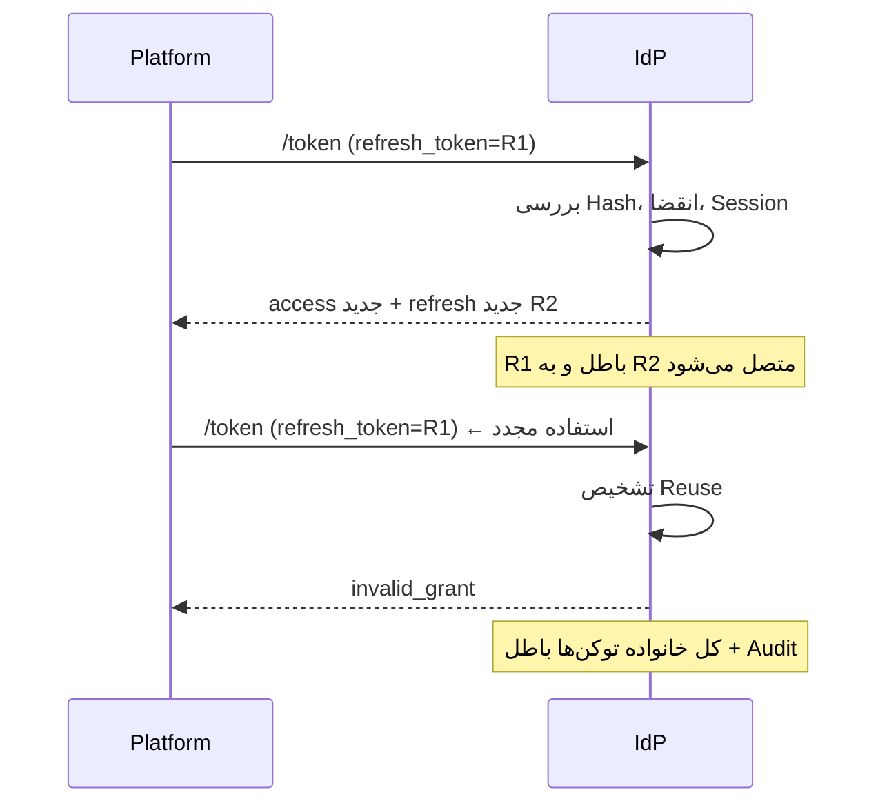
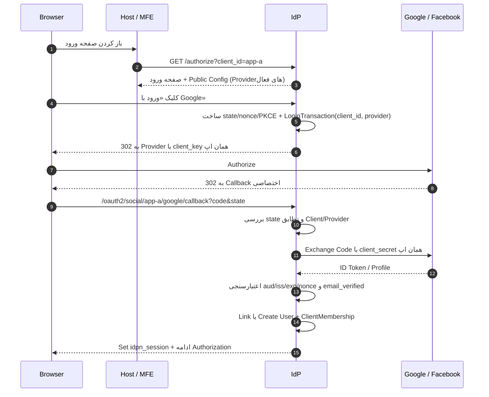

# جریان‌های احراز هویت و توکن

> این سند رفتار دقیق ورود، SSO، توکن، نشست، خروج، MFA و چرخه حساب را تعیین می‌کند. قرارداد Endpointها در [api.md](./api.md) آمده است.

## 1. بازیگران

| بازیگر | نقش |
|---|---|
| کاربر | صاحب حساب |
| مرورگر | نگهدارنده کوکی نشست IdP |
| پلتفرم (Client/RP) | درخواست‌کننده احراز هویت |
| Auth Server (OP) | احراز هویت و صدور توکن |
| Resource Server | API پلتفرم که توکن را اعتبارسنجی می‌کند |
| Admin Panel | کلاینت OIDC مدیریتی |

## 2. جریان اصلی: Authorization Code + PKCE



### 2.1 پارامترهای `/authorize`

| پارامتر | الزام | توضیح |
|---|---|---|
| `response_type` | بله | همیشه `code` |
| `client_id` | بله | شناسه کلاینت |
| `redirect_uri` | بله | تطابق دقیق با مقدار ثبت‌شده |
| `scope` | بله | شامل `openid`؛ `offline_access` برای Refresh Token |
| `state` | بله | مقدار تصادفی و یک‌بارمصرف؛ ضد CSRF |
| `nonce` | بله | ضد Replay در ID Token |
| `code_challenge` | بله | SHA-256 از `code_verifier` |
| `code_challenge_method` | بله | فقط `S256` |
| `prompt` | خیر | `none`، `login`، `consent`، `select_account` |
| `max_age` | خیر | حداکثر عمر احراز هویت (ثانیه) |
| `login_hint` | خیر | پیش‌پر کردن نام کاربری/ایمیل |
| `acr_values` | خیر | درخواست سطح اطمینان (مثلاً MFA) |
| `ui_locales` | خیر | زبان صفحه ورود (مثل `fa-IR`) |
| `login_context` | خیر | انتخاب مدل ورود داخل همان اپ (مثل `customer-admin`) |
| `tenant` | خیر | در صورت چندسازمانی |

### 2.2 اعتبارسنجی در `/authorize`

1. `client_id` وجود دارد و `active` است.
2. `redirect_uri` **دقیقاً** با یکی از مقادیر ثبت‌شده برابر است (بدون Normalize خطرناک).
3. `response_type` فقط `code` است.
4. Scopeها زیرمجموعه Scopeهای مجاز کلاینت هستند.
5. PKCE برای کلاینت‌های عمومی الزامی و برای بقیه توصیه‌شده است.
6. `state` و `nonce` وجود دارند.
7. `login_context` (در صورت ارسال) فعال، متعلق به همین `client_id` و از Contextهای مجاز است.
8. `ui_locales` (در صورت ارسال) یکی از زبان‌های فعال همان کلاینت است؛ در غیر این صورت نادیده گرفته می‌شود.
9. در صورت `prompt=none`: اگر نشست معتبر یا رضایت لازم نباشد، خطای مناسب برگردانده می‌شود.

### 2.5 انتخاب Login Context



- Context در Code، Session و توکن ثبت می‌شود.
- اپ باید `login_context` را از مسیر خودش (مثلاً `/admin` یا `/team`) تعیین کند، نه از ورودی خام کاربر.
- اگر Context انتخاب‌شده `mfa_policy=required_all` داشته باشد، کاربر بدون MFA به مرحله ثبت/تأیید هدایت می‌شود.
- جزئیات کامل: [login-contexts.md](./login-contexts.md).

### 2.6 تعیین زبان صفحه ورود

ترتیب اولویت:

1. `ui_locales` در درخواست
2. `Accept-Language` مرورگر (اگر زبان فعال کلاینت باشد)
3. `locale` پروفایل کاربر
4. `defaultLocale` کلاینت
5. `defaultLocale` سازمان
6. `fa-IR`

- زبان نامعتبر باعث خطا نمی‌شود؛ به مرحله بعد سقوط می‌کند.
- زبان انتخاب‌شده روی ریشه صفحه با `dir` متناظر اعمال می‌شود.
- متن‌ها از Override همان کلاینت (و در صورت وجود، همان Context) خوانده می‌شوند.
- جزئیات کامل: [localization.md](./localization.md).

### 2.3 صدور Code

- Code یک مقدار تصادفی با آنتروپی حداقل 256 بیت است.
- فقط **Hash** آن ذخیره می‌شود.
- عمر 60 ثانیه، یک‌بارمصرف.
- به `client_id`، `redirect_uri`، `code_challenge`، `session_id`، `nonce` و `login_context` مقید است.
- استفاده مجدد از Code باعث رد درخواست، ابطال توکن‌های صادرشده با آن و ثبت رویداد امنیتی می‌شود.

### 2.4 `/token`

| پارامتر | توضیح |
|---|---|
| `grant_type` | `authorization_code` |
| `code` | Code دریافتی |
| `redirect_uri` | باید با مقدار مرحله قبل یکی باشد |
| `client_id` | برای کلاینت عمومی؛ برای محرمانه از Client Authentication |
| `code_verifier` | مقدار خام PKCE |

روش احراز هویت کلاینت:

- `client_secret_basic` (پیشنهادی برای کلاینت محرمانه)
- `client_secret_post` (فقط در صورت پشتیبانی اجباری)
- `none` + PKCE (کلاینت عمومی)

**پاسخ موفق:**

```json
{
  "access_token": "eyJ...",
  "token_type": "Bearer",
  "expires_in": 600,
  "refresh_token": "rft_...",
  "scope": "openid profile email offline_access",
  "id_token": "eyJ..."
}
```

- Access Token و ID Token شامل `login_context` و `locale` هستند.
- نقش‌های درج‌شده فقط از `allowed_roles` همان Context انتخاب می‌شوند.
- Refresh Token به `login_context` همان درخواست مقید است و برای Context دیگر قابل استفاده نیست.

## 3. SSO و احراز هویت بی‌صدا

### 3.1 رفتار

- نشست IdP با کوکی `idpn_session` روی دامنه `auth` نگهداری می‌شود.
- پلتفرم دوم با Redirect به `/authorize` (بدون `prompt=none` هم) نشست معتبر را می‌بیند و بلافاصله Code صادر می‌کند.
- برای بررسی بدون تعامل، پلتفرم از `prompt=none` استفاده می‌کند:
  - نشست معتبر: Code صادر می‌شود.
  - نشست نامعتبر: خطای `login_required` (برای کاربر لاگین‌نشده) یا `interaction_required`.
  - رضایت لازم: `consent_required`.

### 3.2 `max_age` و Step-up

- `max_age=0` یعنی احراز هویت مجدد اجباری است.
- برای عملیات حساس (تغییر رمز، حذف حساب، تغییر نقش ادمین) از `max_age` کوتاه یا `acr_values` بالاتر استفاده می‌شود.
- مقدار `auth_time` در ID Token و Access Token ثبت می‌شود.

### 3.3 `sid`

- هر نشست IdP یک `sid` دارد.
- `sid` در ID Token و Access Token درج می‌شود.
- پلتفرم می‌تواند `sid` را به نشست محلی خود نسبت دهد تا خروج سراسری را تشخیص دهد.
- Back-channel Logout بر پایه `sid` کار می‌کند.

## 4. توکن‌ها

### 4.1 سیاست توکن

| توکن | فرمت | عمر پیش‌فرض | ذخیره‌سازی | یادداشت |
|---|---|---|---|---|
| Authorization Code | Opaque | 60 ثانیه | Hash در DB | یک‌بارمصرف |
| Access Token | JWT (ES256) | 10 دقیقه | فقط در حافظه/Session سرور | `aud` = client_id |
| ID Token | JWT (ES256) | 5 دقیقه | فقط در حافظه/Session سرور | هویت کاربر |
| Refresh Token | Opaque | 30 روز | Hash در DB | چرخشی + تشخیص Reuse |
| Logout Token | JWT (ES256) | 2 دقیقه | ارسال یک‌باره | برای Back-channel |
| Admin Access Token | JWT (ES256) | 5 دقیقه | Session سرور پنل | MFA اجباری |

### 4.2 محتوای Access Token

فیلدهای ثابت: `iss`, `sub`, `aud`, `client_id`, `iat`, `exp`, `auth_time`, `acr`, `amr`, `sid`, `jti`, `tenant_id`.

فیلدهای اختیاری: `roles`, `permissions` (فقط برای همان `aud`).

**قواعد:**

- الگوریتم مجاز فقط `ES256` است؛ `none` و `HS256` پذیرفته نمی‌شوند.
- کلید امضا با `kid` مشخص می‌شود.
- Resource Server باید `iss` و `aud` را بررسی کند.
- عمر توکن قابل تنظیم به‌ازای کلاینت است، اما سقف پیشنهادی 15 دقیقه است.

### 4.3 چرخش Refresh Token



- هر Refresh Token فقط یک بار قابل استفاده است.
- در استفاده مجدد، **تمام خانواده** (`family_id`) باطل می‌شود.
- Refresh Token به `client_id` و `session_id` مقید است.
- با غیرفعال‌شدن کاربر یا ابطال نشست، همه Refresh Tokenها باطل می‌شوند.
- `offline_access` برای صدور Refresh Token الزامی است.
- Refresh Token در کوکی مرورگر ذخیره نمی‌شود.

### 4.4 اعتبارسنجی توکن در API پلتفرم

1. دریافت JWKS از `/.well-known/jwks.json` و کش آن بر اساس `Cache-Control`.
2. بررسی امضا با کلید متناظر `kid`.
3. بررسی `iss` برابر با Issuer مورد انتظار.
4. بررسی `aud` شامل شناسه API/کلاینت.
5. بررسی `exp` و `nbf` با تحمل حداکثر 60 ثانیه.
6. بررسی `tenant_id` در صورت چندسازمانی.
7. بررسی مجوز موردنیاز از `permissions` یا دریافت از `/userinfo`.
8. در صورت شکست هر مرحله: پاسخ `401`.

## 5. نشست

### 5.1 سیاست

| مورد | پیش‌فرض | توضیح |
|---|---|---|
| نام کوکی | `idpn_session` | روی دامنه `auth.<domain>` |
| پرچم‌ها | `HttpOnly; Secure; SameSite=Lax; Path=/` | جلوگیری از دسترسی JS و CSRF |
| Idle Timeout | 30 دقیقه | قابل تنظیم |
| Absolute Timeout | 12 ساعت | قابل تنظیم |
| Remember Me | 30 روز Absolute | Idle همچنان 7 روز |
| نشست ادمین | Idle 15 دقیقه / Absolute 8 ساعت | حساس‌تر |
| حداکثر نشست هم‌زمان | 10 | قابل تنظیم |
| تجدید Idle | هر درخواست معتبر | Sliding Expiration کنترل‌شده |

### 5.2 قواعد

- در ورود موفق، شناسه نشست جدید صادر می‌شود (ضد Session Fixation).
- تغییر رمز عبور یا غیرفعال‌سازی کاربر، نشست‌های فعال را باطل می‌کند.
- IP و User-Agent ثبت می‌شوند اما **مبنای رد قطعی** نیستند (شبکه موبایل تغییر می‌کند)؛ فقط Risk Signal هستند.
- کاربر می‌تواند نشست‌های فعال خود را ببیند و ببندد.
- ادمین می‌تواند نشست یک کاربر را باطل کند.

## 6. خروج (Logout)

### 6.1 دو حالت

| حالت | رفتار | چه زمانی |
|---|---|---|
| **خروج محلی** | فقط نشست پلتفرم پاک می‌شود؛ نشست IdP باقی می‌ماند | دکمه «خروج» در هر پلتفرم |
| **خروج سراسری** | نشست IdP باطل و به همه کلاینت‌ها اطلاع داده می‌شود | «خروج از همه دستگاه‌ها» یا عملیات حساس |

> این تفکیک باعث می‌شود کاربر با خروج از یک پلتفرم، ناخواسته از بقیه خارج نشود، اما گزینه امنیتی خروج کامل هم وجود داشته باشد.

### 6.2 RP-Initiated Logout

درخواست:

```
GET /oauth2/logout
  ?id_token_hint=<ID Token>
  &post_logout_redirect_uri=https://platform-a.example.com/
  &state=<random>
  &client_id=platform-a
```

- `post_logout_redirect_uri` باید با مقدار ثبت‌شده دقیقاً برابر باشد.
- `id_token_hint` برای شناسایی نشست و جلوگیری از Logout CSRF توصیه می‌شود.
- پس از پاک‌کردن کوکی، کاربر به آدرس مجاز هدایت می‌شود.
- در صورت `prompt=login` یا `max_age=0`، پارامترهای اضافی مجاز نیستند مگر مستند شده باشد.

### 6.3 Back-channel Logout

- برای هر کلاینت `backchannel_logout_uri` ثبت می‌شود.
- IdP یک **Logout Token** امضاشده با ES256 ارسال می‌کند:

```json
{
  "iss": "https://auth.example.com",
  "aud": "platform-a",
  "iat": 1760000000,
  "exp": 1760000120,
  "jti": "logout-...",
  "sub": "e6f0c2a1-...",
  "sid": "c1a2...",
  "events": {
    "http://schemas.openid.net/event/backchannel-logout": {}
  }
}
```

- کلاینت باید امضا، `iss`، `aud`، `iat`، `jti` (ضد Replay) را بررسی کند.
- Logout Token نباید `nonce` داشته باشد.
- ارسال به‌صورت POST با `Content-Type: application/x-www-form-urlencoded` و پارامتر `logout_token`.
- خطای کلاینت نباید خروج کاربر را متوقف کند؛ در صف Retry ثبت می‌شود.

### 6.4 Front-channel Logout (اختیاری)

- برای کلاینت‌هایی که Back-channel پشتیبانی نمی‌کنند.
- IFrame به آدرس Logout کلاینت با پارامتر `iss` و `sid`.
- به‌دلیل محدودیت‌های کوکی Third-Party، فقط در شرایط خاص استفاده شود.

### 6.5 ابطال توکن

- `POST /oauth2/revoke` برای Refresh Token و Access Token.
- ابطال Access Token با توجه به ماهیت JWT تا انقضا اثر کامل ندارد؛ برای ابطال فوری، نشست و Refresh Token باطل می‌شوند و Resource Server می‌تواند `sid` را با لیست ابطال بررسی کند (اختیاری).
- `POST /oauth2/introspect` برای سرویس‌هایی که اعتبارسنجی محلی ندارند.

## 7. ورود دومرحله‌ای (MFA)

### 7.1 روش‌ها

| روش | فاز | توضیح |
|---|---|---|
| TOTP | 4 | Google Authenticator و مشابه |
| WebAuthn / Passkey | 4 | امن‌ترین روش؛ ضد Phishing |
| کد بازیابی | 4 | 10 کد یک‌بارمصرف |
| OTP پیامکی | 5 (اختیاری) | به‌عنوان روش پشتیبان، نه اصلی |
| Email OTP | 5 (اختیاری) | — |

### 7.2 ثبت (Enrollment)

1. کاربر از تنظیمات امنیتی، روش را انتخاب می‌کند.
2. TOTP: نمایش QR + Secret، تأیید با یک کد معتبر.
3. WebAuthn: ثبت Credential با چالش تصادفی و بررسی Origin/RP ID.
4. تولید کدهای بازیابی و نمایش یک‌باره.
5. ثبت Audit و ارسال ایمیل اطلاع‌رسانی.

### 7.3 ورود

- اگر کاربر MFA فعال دارد، پس از رمز صحیح، مرحله دوم نمایش داده می‌شود.
- سیاست «اجباری برای ادمین‌ها» در تنظیمات کلاینت/نقش تعیین می‌شود.
- پس از موفقیت، `amr` شامل روش‌های استفاده‌شده و `acr` مقدار `urn:on4net:acr:mfa` می‌گیرد.

### 7.4 Step-up

- برای عملیات حساس، پلتفرم می‌تواند `acr_values=urn:on4net:acr:mfa` یا `max_age=0` بفرستد.
- اگر نشست فعلی سطح کافی نداشته باشد، IdP احراز هویت مجدد انجام می‌دهد.
- برای تغییر نقش‌های ادمینی در پنل، همیشه Step-up الزامی است.

### 7.5 بازیابی

- کدهای بازیابی یک‌بارمصرف و Hash‌شده.
- در صورت گم‌شدن همه روش‌ها، فرایند بازیابی با تأیید هویت (پشتیبانی/ایمیل) و ثبت Audit.
- حذف آخرین روش MFA برای نقش‌های اجباری ممنوع است.

## 8. چرخه حساب

### 8.1 ثبت‌نام

- پیش‌فرض: **فقط با دعوت** (Invite-only) توسط ادمین.
- ثبت‌نام آزاد به‌ازای هر کلاینت قابل فعال‌سازی است.
- سیاست پیش‌فرض برای پلتفرم‌های داخلی: دعوت‌محور.

### 8.2 دعوت

1. ادمین ایمیل کاربر را وارد می‌کند.
2. توکن دعوت تصادفی، Hash‌شده، یک‌بارمصرف، 72 ساعت اعتبار.
3. کاربر از طریق لینک، رمز عبور تعیین می‌کند.
4. نقش پیش‌فرض (در صورت تعریف) تخصیص می‌یابد.
5. Audit ثبت می‌شود.

### 8.3 تأیید ایمیل

- توکن 24 ساعته، یک‌بارمصرف، Hash‌شده.
- تا تأیید نشدن، برخی Scopeها (`email`) قابل استفاده نیستند (قابل تنظیم).
- ارسال مجدد با Rate Limit.

### 8.4 بازنشانی رمز عبور

- پاسخ همیشه یکسان است (ضد Account Enumeration).
- توکن 30 دقیقه، یک‌بارمصرف، Hash‌شده.
- پس از تغییر رمز، همه نشست‌ها و Refresh Tokenها باطل می‌شوند.
- ایمیل اطلاع‌رسانی تغییر رمز ارسال می‌شود.

### 8.5 سیاست رمز عبور

- حداقل 12 کاراکتر، حداکثر 128.
- بدون اجبار ترکیب حروف/اعداد/نماد (طبق NIST).
- رد رمزهای رایج و رمزهای شامل ایمیل/نام کاربری.
- بررسی Breached Password (اختیاری، با k-anonymity).
- Hash با Argon2id (پارامترها در [security.md](./security.md)).
- تغییر رمز هر 90 روز **اجباری نیست** مگر سیاست سازمانی بخواهد.

### 8.6 غیرفعال‌سازی و حذف

- `disabled`: ورود ممنوع، توکن‌ها باطل، داده حفظ می‌شود.
- حذف: حذف نرم 30 روزه، سپس ناشناس‌سازی؛ Audit حفظ می‌شود.
- حذف حساب توسط خود کاربر در صورت فعال‌بودن سیاست.

### 8.7 عضویت در اپلیکیشن (Client Membership)

- هر کاربر یک هویت مرکزی دارد و می‌تواند در چند اپ عضو باشد.
- عضویت هر اپ جداگانه است (`ClientMembership`) و شامل وضعیت، ویژگی‌های اختصاصی و نقش‌های همان اپ است.
- ادمین هر اپ می‌تواند کاربر را دعوت کند؛ اگر کاربر وجود داشته باشد، فقط Membership جدید ساخته می‌شود.
- نقش‌های پیش‌فرض کلاینت در اولین عضویت تخصیص می‌یابند.
- `suspended` شدن Membership فقط دسترسی همان اپ را قطع می‌کند؛ کاربر می‌تواند در اپ‌های دیگر فعال بماند.
- حذف Membership کاربر مرکزی را حذف نمی‌کند.
- هیچ اپی کاربر تکراری با رمز عبور جدا نمی‌سازد؛ هویت یکی است.
- در حالت `self_service`، ثبت‌نام از طریق همان اپ باعث ایجاد خودکار Membership و نقش پیش‌فرض می‌شود.
- در حالت `invite_only`، بدون دعوت معتبر Membership ساخته نمی‌شود.

## 9. ورود اجتماعی (Social Login)

### 9.1 مدل

- هر اپلیکیشن می‌تواند Google و/یا Facebook را با **Client ID/Secret اختصاصی خودش** فعال کند.
- تنظیمات در `ClientSocialProvider` نگهداری می‌شود؛ Secret رمزنگاری‌شده و فقط در سرور است.
- صفحه ورود بر اساس `client_id` فقط Providerهای فعال همان اپ را نمایش می‌دهد.
- Callback اختصاصی هر اپ و Provider:

```
https://auth.example.com/oauth2/social/{clientId}/{provider}/callback
```

- این URL باید در کنسول همان Provider و با Credential همان اپ ثبت شود.

### 9.2 جریان



### 9.3 قواعد اتصال حساب (Account Linking)

| وضعیت | رفتار |
|---|---|
| ایمیل تأییدشده با کاربر موجود مطابق است | Identity به کاربر موجود متصل می‌شود (با Audit) |
| ایمیل تأییدنشده | اتصال خودکار ممنوع؛ ابتدا تأیید ایمیل یا حساب جدا |
| Identity قبلاً به کاربر دیگری متصل است | ورود رد می‌شود و فرایند پشتیبانی آغاز می‌شود |
| کاربر موجود است اما Membership اپ ندارد | Membership ساخته و نقش پیش‌فرض تخصیص می‌یابد |
| Membership اپ `suspended` است | ورود به آن اپ رد می‌شود؛ سایر اپ‌ها تحت تأثیر نیستند |
| Provider غیرفعال یا حذف‌شده | دکمه نمایش داده نمی‌شود و درخواست مستقیم رد می‌شود |

> نکته: شناسه کاربر در Facebook به‌ازای هر App یکسان نیست (App-scoped ID)؛ بنابراین یک شخص ممکن است برای هر اپ Identity جدا داشته باشد. اتصال به کاربر مرکزی باید از طریق ایمیل Verified انجام شود، نه شناسه Provider.

### 9.4 امنیت

- `state` و `nonce` اجباری و یک‌بارمصرف؛ `state` به `client_id` و `provider` مقید است.
- PKCE برای Google استفاده می‌شود (Facebook در صورت پشتیبانی).
- Callback دقیقاً با مقدار ثبت‌شده تطابق دارد؛ `client_id` مسیر با Credential استفاده‌شده یکی است.
- اعتبارسنجی Google ID Token: امضا، `iss`، `aud` برابر `client_key`، `exp`، `nonce`، `email_verified`.
- Facebook: دریافت پروفایل با Graph API و Access Token سمت سرور؛ به داده ارسالی مرورگر اعتماد نمی‌شود.
- توکن‌های Provider ذخیره نمی‌شوند؛ در صورت نیاز موقت، رمزنگاری‌شده و کوتاه‌عمر.
- Secret فقط در سرور و رمزنگاری‌شده؛ هرگز در پاسخ API یا MFE.
- Rate Limit روی شروع سوشال و Callback.
- پیام خطا عمومی و بدون افشای وجود حساب.
- ورود سوشال برای پنل ادمین غیرفعال یا محدود به Provider سازمانی است.

### 9.5 خطاهای سوشال

| خطا | معنا | رفتار |
|---|---|---|
| `social_provider_disabled` | Provider برای این اپ فعال نیست | نمایش ندادن دکمه/خطای عمومی |
| `social_state_invalid` | State نامعتبر یا منقضی | شروع مجدد ورود |
| `social_email_unverified` | ایمیل Provider تأیید نشده | درخواست تأیید ایمیل |
| `social_account_conflict` | Identity به کاربر دیگری متصل است | پیام پشتیبانی |
| `social_provider_error` | خطای Provider یا شبکه | Retry محدود و بازگشت به ورود رمز |
| `social_membership_suspended` | عضویت اپ غیرفعال است | پیام دسترسی به این اپ |

### 9.6 راه‌اندازی Provider برای هر اپ

1. اپ در کنسول Google/Facebook یک OAuth App با Credential اختصاصی می‌سازد.
2. Callback اختصاصی `.../social/{clientId}/{provider}/callback` را ثبت می‌کند.
3. ادمین اپ (یا ادمین سراسری) Credential را در پنل وارد می‌کند.
4. Provider فعال می‌شود و در Public Config همان اپ ظاهر می‌شود.
5. تغییر Credential نیازمند Step-up و ثبت Audit است.

## 10. Client Credentials (M2M)

```
POST /oauth2/token
grant_type=client_credentials
client_id=service-x
client_secret=...
scope=service-x:jobs:run
```

- توکن بدون `sub` کاربر و با `sub` سرویس صادر می‌شود.
- عمر کوتاه (5 دقیقه پیشنهادی)، بدون Refresh Token.
- نقش‌ها به‌صورت مستقیم به Service Account تخصیص می‌یابند.
- Secret باید دوره‌ای چرخش شود.

## 11. خطاهای استاندارد

| خطا | معنا | رفتار پلتفرم |
|---|---|---|
| `invalid_request` | پارامتر نامعتبر/ناقص | نمایش خطا، عدم تلاش مجدد |
| `invalid_client` | احراز هویت کلاینت ناموفق | خطای سرور، بررسی Secret |
| `invalid_grant` | Code/Refresh نامعتبر یا منقضی | شروع مجدد ورود |
| `unauthorized_client` | کلاینت مجاز به این Grant نیست | خطای پیکربندی |
| `unsupported_grant_type` | Grant پشتیبانی نمی‌شود | خطای پیکربندی |
| `invalid_scope` | Scope مجاز نیست | اصلاح درخواست |
| `access_denied` | کاربر انصراف داد | بازگشت به صفحه قبل |
| `login_required` | نشست معتبر نیست (با `prompt=none`) | Redirect به ورود تعاملی |
| `consent_required` | رضایت لازم است | نمایش Consent |
| `interaction_required` | تعامل بیشتر لازم است | Redirect به ورود |
| `temporarily_unavailable` | خطای موقت | Retry با Backoff |

**قواعد امنیتی پیام خطا:**

- پیام‌های ورود نباید مشخص کنند ایمیل وجود دارد یا نه.
- جزئیات خطا فقط در لاگ سرور ثبت شود، نه در پاسخ کاربر.
- `error_description` هرگز شامل Secret، توکن یا داده شخصی نباشد.

## 12. سناریوهای لبه

| سناریو | رفتار |
|---|---|
| ورود هم‌زمان دو پلتفرم | دو Code مستقل، یک نشست IdP؛ هر دو معتبر |
| بستن مرورگر | کوکی Session (بدون Remember Me) پاک می‌شود |
| تغییر رمز در پلتفرم A | همه نشست‌ها باطل؛ پلتفرم B در درخواست بعدی 401 می‌گیرد |
| غیرفعال‌سازی کاربر توسط ادمین | نشست و Refresh باطل؛ Back-channel Logout ارسال می‌شود |
| Reuse Refresh Token | کل خانواده باطل + هشدار امنیتی |
| ساعت کلاینت ناهمگام | تحمل 60 ثانیه؛ توصیه NTP |
| از دست رفتن پاسخ `/token` | پلتفرم نباید Code را دوباره استفاده کند؛ باید ورود را از سر بگیرد |
| چند مرورگر | هر مرورگر نشست مستقل؛ مدیریت نشست‌ها قابل مشاهده |
| کاربر در اپ A مسدود، در اپ B فعال | فقط توکن/دسترسی اپ A رد می‌شود |
| Credential سوشال یک اپ خراب است | فقط سوشال همان اپ خطا می‌دهد؛ ورود رمز و سایر اپ‌ها سالم‌اند |
