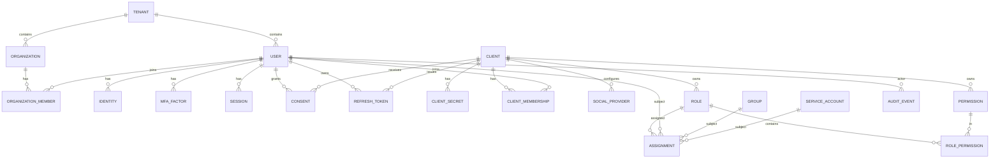

# مدل داده و مدل دسترسی

> این سند موجودیت‌های اصلی، روابط، مدل RBAC، محتوای توکن و سیاست نگهداشت داده را تعریف می‌کند.

## 1. نمودار موجودیت‌ها



## 2. موجودیت‌ها

### 2.1 Tenant (اختیاری در فاز اول)

| فیلد | نوع | توضیح |
|---|---|---|
| `id` | UUID | شناسه |
| `slug` | string unique | نام کوتاه |
| `name` | string | نام نمایشی |
| `status` | enum | `active`, `suspended` |
| `created_at` | timestamp | — |

> حتی در حالت تک‌سازمانی، رکورد پیش‌فرض `default` ساخته می‌شود تا مهاجرت بعدی ساده باشد.

### 2.1.1 Organization (اختیاری)

برای تفکیک اعضا در سطح واحدهای داخلی (مثلاً شعبه یا شرکت زیرمجموعه) در صورت نیاز.

| فیلد | نوع | توضیح |
|---|---|---|
| `id` | UUID | شناسه |
| `tenant_id` | UUID | سازمان بالادست |
| `slug` | string | یکتا در Tenant |
| `name` | string | نام نمایشی |
| `status` | enum | `active`, `archived` |
| `created_at` | timestamp | — |

`OrganizationMember` رابطه کاربر و سازمان را نگه می‌دارد: `organization_id`, `user_id`, `joined_at` (یکتایی ترکیبی).

> اگر فاز اول تک‌سازمانی است، این جدول خالی می‌ماند و همه تخصیص‌ها با `scope_type=global` انجام می‌شود.

### 2.2 User

| فیلد | نوع | توضیح |
|---|---|---|
| `id` | UUID | `sub` در توکن |
| `tenant_id` | UUID | سازمان |
| `username` | string | یکتا در Tenant؛ قابل تغییر با محدودیت |
| `email` | string | یکتا در Tenant (Normalize lowercase) |
| `email_verified_at` | timestamp? | زمان تأیید ایمیل |
| `phone` | string? | یکتا در صورت وجود |
| `phone_verified_at` | timestamp? | زمان تأیید موبایل |
| `display_name` | string | نام نمایشی |
| `avatar_url` | string? | تصویر پروفایل |
| `locale` | string | پیش‌فرض `fa-IR` |
| `status` | enum | `active`, `locked`, `disabled`, `pending` |
| `password_hash` | string? | Argon2id؛ برای کاربران صرفاً OTP/اجتماعی خالی است |
| `password_changed_at` | timestamp? | برای ابطال نشست‌های قدیمی |
| `must_change_password` | boolean | اجبار تغییر در اولین ورود |
| `failed_login_count` | int | شمارنده قفل موقت |
| `locked_until` | timestamp? | پایان قفل |
| `last_login_at` | timestamp? | — |
| `created_at` / `updated_at` | timestamp | — |
| `deleted_at` | timestamp? | حذف نرم |

**قواعد:**

- ایمیل و نام کاربری حساس به حروف بزرگ/کوچک نیستند.
- کاربر `disabled` هیچ توکن جدیدی نمی‌گیرد و Refresh Tokenهایش باطل می‌شوند.
- کاربر `locked` فقط پس از پایان قفل یا بازکردن توسط ادمین می‌تواند وارد شود.
- رمز عبور هرگز به‌صورت متن ساده ذخیره یا لاگ نمی‌شود.

### 2.3 Identity

برای اتصال چند روش ورود به یک کاربر.

| فیلد | نوع | توضیح |
|---|---|---|
| `id` | UUID | — |
| `user_id` | UUID | — |
| `provider` | enum | `password`, `google`, `facebook`, `microsoft`, `github`, `otp` |
| `provider_user_id` | string | شناسه در Provider؛ یکتا با `provider` |
| `metadata` | jsonb | اطلاعات کمکی (بدون توکن حساس) |
| `created_at` | timestamp | — |

### 2.4 MFA Factor

| فیلد | نوع | توضیح |
|---|---|---|
| `id` | UUID | — |
| `user_id` | UUID | — |
| `type` | enum | `totp`, `webauthn` |
| `name` | string | نام دستگاه |
| `secret_encrypted` | bytea? | فقط TOTP؛ رمزنگاری‌شده |
| `credential_id` | bytea? | فقط WebAuthn |
| `public_key` | bytea? | فقط WebAuthn |
| `sign_count` | bigint | ضد-Clone برای WebAuthn |
| `confirmed_at` | timestamp? | تأیید نهایی ثبت |
| `last_used_at` | timestamp? | — |

### 2.5 Client (پلتفرم)

| فیلد | نوع | توضیح |
|---|---|---|
| `id` | UUID | — |
| `client_id` | string unique | شناسه عمومی، مثلاً `platform-a` |
| `name` | string | نام نمایشی |
| `type` | enum | `web` (محرمانه), `spa` (عمومی), `mobile`, `m2m` |
| `redirect_uris` | text[] | تطابق دقیق (Exact Match) |
| `post_logout_redirect_uris` | text[] | — |
| `allowed_origins` | text[] | فقط برای CORS در صورت نیاز |
| `scopes` | text[] | Scopeهای مجاز |
| `access_token_ttl` | int | ثانیه؛ پیش‌فرض 600 |
| `refresh_token_ttl` | int | ثانیه؛ پیش‌فرض 2592000 |
| `require_pkce` | boolean | برای SPA/Mobile همیشه true |
| `backchannel_logout_uri` | text? | دریافت Logout Token |
| `frontchannel_logout_uri` | text? | اختیاری |
| `registration_policy` | enum | `invite_only`, `self_service`, `disabled` |
| `mfa_policy` | enum | `optional`, `required_admins`, `required_all` |
| `allowed_email_domains` | text[] | محدودیت دامنه ایمیل برای ثبت‌نام/سوشال |
| `branding` | jsonb | لوگو، رنگ‌ها، لینک‌های پشتیبانی |
| `mfe_features` | jsonb | فعال/غیرفعال‌کردن ماژول‌های MFE |
| `membership_schema` | jsonb? | Schema فیلدهای اختصاصی اپ (JSON Schema) |
| `status` | enum | `active`, `disabled` |
| `tenant_id` | UUID | — |
| `created_at` / `updated_at` | timestamp | — |

> Admin API برای ارجاع به کلاینت از `client_id` عمومی استفاده می‌کند و آن را به `Client.id` داخلی نگاشت می‌کند.

### 2.6 Client Secret

| فیلد | نوع | توضیح |
|---|---|---|
| `id` | UUID | — |
| `client_id` | UUID | FK |
| `secret_hash` | string | Hash با Argon2id یا SHA-256 + Salt |
| `prefix` | string | چند کاراکتر اول برای شناسایی |
| `expires_at` | timestamp? | برای چرخش |
| `revoked_at` | timestamp? | — |
| `created_at` | timestamp | — |

> Secret فقط یک بار در زمان ساخت/چرخش نمایش داده می‌شود.

### 2.6.1 Client Social Provider

تنظیمات سوشال لاگین مخصوص هر اپلیکیشن. هر اپ می‌تواند Credential خودش را داشته باشد.

| فیلد | نوع | توضیح |
|---|---|---|
| `id` | UUID | — |
| `client_id` | UUID | FK به Client |
| `provider` | enum | `google`, `facebook` (قابل گسترش) |
| `client_key` | string | Client ID عمومی Provider |
| `client_secret_encrypted` | bytea | Secret رمزنگاری‌شده با AES-256-GCM |
| `scopes` | text[] | حداقل `openid email profile` (بسته به Provider) |
| `allowed_email_domains` | text[]? | محدودیت دامنه اختیاری |
| `enabled` | boolean | نمایش در صفحه ورود همان اپ |
| `created_at` / `updated_at` | timestamp | — |

**قواعد:**

- یکتایی `(client_id, provider)`.
- Secret هرگز در پاسخ API برنمی‌گردد.
- Callback اختصاصی: `/oauth2/social/{clientId}/{provider}/callback`.
- ادمین اپ می‌تواند فقط Providerهای اپ خودش را ببیند/تغییر دهد.
- تغییر Credential نیازمند Step-up و ثبت Audit است.

### 2.6.2 Client Membership

عضویت کاربر در یک اپلیکیشن. هویت کاربر مرکزی است، اما وضعیت و ویژگی‌های هر اپ جدا نگهداری می‌شود.

| فیلد | نوع | توضیح |
|---|---|---|
| `id` | UUID | — |
| `client_id` | UUID | اپلیکیشن |
| `user_id` | UUID | کاربر مرکزی |
| `status` | enum | `invited`, `active`, `suspended` |
| `attributes` | jsonb | فیلدهای اختصاصی همان اپ (مطابق `membership_schema`) |
| `invited_by` | UUID? | ادمین دعوت‌کننده |
| `invited_at` | timestamp? | — |
| `joined_at` | timestamp? | — |
| `last_access_at` | timestamp? | — |
| `created_at` / `updated_at` | timestamp | — |

**قواعد:**

- یکتایی `(client_id, user_id)`.
- `suspended` یعنی کاربر نمی‌تواند برای آن اپ توکن جدید بگیرد؛ Refresh Tokenهای همان اپ باطل می‌شوند.
- حذف Membership کاربر را حذف نمی‌کند؛ فقط دسترسی به آن اپ قطع می‌شود.
- نقش‌های پیش‌فرض کلاینت در اولین عضویت تخصیص می‌یابند.
- `attributes` فقط در توکن همان اپ و فقط برای همان `aud` درج می‌شود.
- ادمین اپ فقط Membershipهای اپ خودش را می‌بیند و تغییر می‌دهد.

### 2.7 Scope

Scopeها سطح دسترسی درخواستی کلاینت را مشخص می‌کنند (نه مجوز ریز).

| Scope | معنا |
|---|---|
| `openid` | الزامی برای OIDC |
| `profile` | نام، تصویر، Locale |
| `email` | ایمیل و وضعیت تأیید |
| `phone` | شماره موبایل |
| `offline_access` | صدور Refresh Token |
| `idp.admin` | دسترسی Global Admin به Admin API (فقط پنل ادمین سراسری) |
| `idp.client-admin` | دسترسی Delegated Admin به Admin API برای همان اپ (با `aud` = client) |

مجوزهای ریز از طریق Role/Permission مدیریت می‌شوند، نه Scope.

### 2.8 Permission

| فیلد | نوع | توضیح |
|---|---|---|
| `id` | UUID | — |
| `key` | string unique | مثل `platform-a:contact:read` |
| `client_id` | UUID? | `null` = سراسری |
| `description` | string | — |

**قالب کلید:** `<platform>:<resource>:<action>`

نمونه‌ها:

- `platform-a:contact:read`
- `platform-a:contact:write`
- `platform-a:report:export`
- `idp:user:read` (سراسری، فقط ادمین)

### 2.9 Role

| فیلد | نوع | توضیح |
|---|---|---|
| `id` | UUID | — |
| `key` | string unique | مثل `platform-a:admin` |
| `name` | string | نام نمایشی |
| `client_id` | UUID? | `null` = نقش سراسری |
| `is_default` | boolean | تخصیص خودکار در اولین ورود |
| `description` | string | — |
| `created_at` / `updated_at` | timestamp | — |

**نقش‌های پیش‌فرض پیشنهادی:**

| نقش | Scope | مجوزها |
|---|---|---|
| `idp:superadmin` | سراسری | همه مجوزهای `idp:*` |
| `idp:security-admin` | سراسری | مدیریت کلید، نشست، Audit، MFA |
| `idp:support` | سراسری | مشاهده کاربر، بازنشانی رمز، بدون تغییر نقش |
| `platform-a:admin` | پلتفرم A | همه مجوزهای `platform-a:*` |
| `platform-a:user-admin` | پلتفرم A | `idp:client-member:*`، `idp:client-role:*`، `idp:social-provider:*`، `idp:client-session:read` |
| `platform-a:member` | پلتفرم A | خواندن + نوشتن منابع عادی |
| `platform-a:viewer` | پلتفرم A | فقط خواندن |
| `org:owner` | سازمان | مدیریت اعضای همان سازمان |
| `org:member` | سازمان | دسترسی اعضای سازمان |

> نقش‌های `idp:*` هرگز در توکن کلاینت‌های عادی قرار نمی‌گیرند.

### 2.10 Role Permission

| فیلد | نوع |
|---|---|
| `role_id` | UUID |
| `permission_id` | UUID |

### 2.11 Assignment (تخصیص نقش)

| فیلد | نوع | توضیح |
|---|---|---|
| `id` | UUID | — |
| `subject_type` | enum | `user`, `group`, `service` |
| `subject_id` | UUID | — |
| `role_id` | UUID | — |
| `scope_type` | enum | `global`, `organization` |
| `scope_id` | UUID? | برای `global` خالی؛ برای `organization` شناسه سازمان |
| `expires_at` | timestamp? | تخصیص موقت |
| `assigned_by` | UUID | ادمین |
| `created_at` | timestamp | — |

**قواعد:**

- دامنه پلتفرم از خودِ Role می‌آید (`Role.client_id`)؛ بنابراین برای نقش‌های پلتفرمی نیازی به Scope جداگانه نیست.
- `scope_type=organization` فقط برای نقش‌هایی است که باید به اعضای یک سازمان محدود شوند.
- یکتایی: `(subject_type, subject_id, role_id, scope_type, scope_id)`.
- تخصیص منقضی در محاسبه مجوزها نادیده گرفته می‌شود.
- حذف نقش باید ابتدا تخصیص‌ها را بررسی کند (یا Cascade کنترل‌شده).
- تخصیص نقش حساس (`idp:superadmin`) نیازمند MFA تازه (Step-up) و ثبت Audit است.
- Admin API برای ارجاع به کلاینت از `clientId` عمومی استفاده می‌کند و آن را به `Client.id` داخلی نگاشت می‌کند.

### 2.12 Group (اختیاری)

| فیلد | نوع | توضیح |
|---|---|---|
| `id` | UUID | — |
| `name` | string | — |
| `tenant_id` | UUID | — |

`GroupMember` رابطه چندبه‌چند کاربر و گروه را نگه می‌دارد. تخصیص نقش به گروه، به همه اعضا اعمال می‌شود.

### 2.13 Service Account

برای ارتباط ماشین‌به‌ماشین.

| فیلد | نوع | توضیح |
|---|---|---|
| `id` | UUID | `sub` در توکن |
| `client_id` | UUID | کلاینت M2M |
| `name` | string | — |
| `status` | enum | `active`, `disabled` |
| `created_at` | timestamp | — |

### 2.14 Session

| فیلد | نوع | توضیح |
|---|---|---|
| `id` | UUID | همان `sid` |
| `user_id` | UUID | — |
| `client_id` | UUID? | آخرین کلاینتی که نشست را ایجاد کرد |
| `created_at` | timestamp | — |
| `last_seen_at` | timestamp | — |
| `idle_expires_at` | timestamp | — |
| `absolute_expires_at` | timestamp | — |
| `ip` | inet | — |
| `user_agent` | text | — |
| `amr` | text[] | روش‌های احراز هویت (مثل `pwd`, `totp`, `webauthn`) |
| `acr` | string | سطح اطمینان |
| `revoked_at` | timestamp? | — |
| `revoke_reason` | string? | `logout`, `admin`, `reuse_detected`, `password_change` |

### 2.15 Authorization Code

| فیلد | نوع | توضیح |
|---|---|---|
| `code_hash` | string | Hash؛ متن ساده ذخیره نمی‌شود |
| `client_id` | UUID | — |
| `user_id` | UUID | — |
| `session_id` | UUID | — |
| `redirect_uri` | text | باید با درخواست تطابق دقیق داشته باشد |
| `scope` | text[] | — |
| `nonce` | string? | — |
| `code_challenge` / `code_challenge_method` | string | S256 الزامی |
| `auth_time` | timestamp | — |
| `acr` / `amr` | string / text[] | — |
| `expires_at` | timestamp | 60 ثانیه |
| `consumed_at` | timestamp? | یک‌بارمصرف |

### 2.16 Refresh Token

| فیلد | نوع | توضیح |
|---|---|---|
| `token_hash` | string | Hash |
| `family_id` | UUID | برای تشخیص Reuse |
| `client_id` | UUID | — |
| `user_id` | UUID | — |
| `session_id` | UUID | — |
| `scope` | text[] | — |
| `expires_at` | timestamp | — |
| `rotated_at` | timestamp? | — |
| `revoked_at` | timestamp? | — |
| `replaced_by` | UUID? | — |

### 2.17 Consent

| فیلد | نوع | توضیح |
|---|---|---|
| `user_id` | UUID | — |
| `client_id` | UUID | — |
| `scopes` | text[] | — |
| `granted_at` | timestamp | — |
| `revoked_at` | timestamp? | — |

> برای پلتفرم‌های داخلی و مورد اعتماد، صفحه Consent اجباری نیست. برای کلاینت‌های ثالث یا Scopeهای حساس (`phone`, `email`) نمایش داده می‌شود.

### 2.18 Audit Event

| فیلد | نوع | توضیح |
|---|---|---|
| `id` | UUID | — |
| `occurred_at` | timestamp | ایندکس‌شده |
| `actor_type` | enum | `user`, `admin`, `service`, `system`, `anonymous` |
| `actor_id` | UUID? | — |
| `action` | string | مثل `user.login.succeeded`, `role.assigned` |
| `target_type` | string? | — |
| `target_id` | UUID? | — |
| `client_id` | UUID? | — |
| `ip` | inet | — |
| `user_agent` | text | — |
| `result` | enum | `success`, `failure` |
| `metadata` | jsonb | بدون داده حساس |

رویدادهای حداقلی: ورود موفق/ناموفق، خروج، MFA ثبت/حذف، بازنشانی رمز، تغییر نقش، ایجاد/غیرفعال‌سازی کاربر، تغییر کلاینت، چرخش کلید، ابطال نشست، تشخیص Reuse.

### 2.19 Signing Key

| فیلد | نوع | توضیح |
|---|---|---|
| `kid` | string | شناسه کلید |
| `alg` | enum | `ES256` |
| `public_key` | text | JWK |
| `private_key_ref` | string | مرجع KMS/Vault |
| `status` | enum | `active`, `retired`, `revoked` |
| `created_at` / `retired_at` | timestamp | — |

## 3. مدل RBAC

### 3.1 تعریف

- **Permission:** کوچک‌ترین واحد دسترسی (`platform-a:contact:read`).
- **Role:** مجموعه‌ای از Permissionها.
- **Assignment:** اتصال یک Subject (کاربر/گروه/سرویس) به یک Role در یک Scope.
- **Client Membership:** عضویت کاربر در یک اپ با وضعیت و ویژگی‌های اختصاصی همان اپ.
- **Delegated Admin:** ادمین محدود به یک اپ که فقط داده و نقش‌های همان اپ را مدیریت می‌کند.

### 3.2 محاسبه مجوز مؤثر

برای توکنی که برای کلاینت `C` صادر می‌شود:

```
assignedRoles = roles assigned to subject (scope global)
              ∪ roles assigned with scope_type=organization
                where subject is member of that organization

effectiveRoles = assignedRoles where role.client_id is null OR role.client_id = C

permissions = ∪ permissions(effectiveRoles)
```

سپس فیلتر نهایی:

```
result = { p ∈ permissions | p.client_id is null OR p.client_id = C }
```

**قواعد:**

- نقش‌های `idp:*` هرگز به کلاینت‌های عادی داده نمی‌شوند (حتی اگر اشتباهاً تخصیص داده شوند).
- تخصیص منقضی‌شده نادیده گرفته می‌شود.
- در صورت حجم زیاد مجوزها (بیش از حدود 2KB)، به‌جای درج در توکن از `/userinfo` یا Introspection استفاده می‌شود.
- تصمیم دسترسی نهایی در API پلتفرم گرفته می‌شود؛ Claim فقط داده است.

### 3.3 کاتالوگ مجوز و نقش هر اپلیکیشن

برای اینکه مدل دسترسی به همه اپ‌ها پاسخ دهد:

- هر اپ **کاتالوگ مجوز خودش** را دارد؛ مجوزها با پیشوند `client_id` نام‌گذاری می‌شوند:
  - `platform-a:contact:read`
  - `platform-a:contact:write`
  - `platform-a:report:export`
- اپ می‌تواند مجوزهایش را از طریق Admin API تعریف کند؛ مجوز سراسری فقط توسط ادمین سراسری ساخته می‌شود.
- Roleها می‌توانند:
  - مخصوص یک اپ باشند (`Role.client_id = C`)
  - یا سراسری باشند (`Role.client_id = null`) و در چند اپ استفاده شوند
- نقش‌های پیش‌فرض هر اپ (`is_default`) در اولین عضویت تخصیص می‌یابند.
- مجوزهای یک اپ هرگز در توکن اپ دیگر قرار نمی‌گیرند.
- اپ‌هایی که سیستم مجوز داخلی دارند، فقط کلید مجوز را در IdP نگاشت می‌کنند؛ IdP جایگزین بررسی سطح ردیف داده نیست.
- اگر اپ به سیاست شرطی (ABAC) نیاز دارد، IdP هویت/نقش/ویژگی‌ها را در توکن می‌دهد و تصمیم نهایی در اپ یا یک Policy Decision Point جدا گرفته می‌شود.
- برای نیازهای خاص هر اپ، `ClientMembership.attributes` در Claim `membership` همان اپ قرار می‌گیرد.

**نمونه کاتالوگ:**

| اپ | نقش | مجوزها |
|---|---|---|
| `crm` | `crm:admin` | `crm:contact:*`, `crm:report:*` |
| `crm` | `crm:member` | `crm:contact:read`, `crm:contact:write` |
| `shop` | `shop:admin` | `shop:order:*`, `shop:product:*` |
| `shop` | `shop:viewer` | `shop:order:read`, `shop:product:read` |

### 3.4 ادمین واگذارشده (Delegated Admin)

هر اپ می‌تواند ادمین خودش را داشته باشد بدون دسترسی به بقیه اپ‌ها:

| نقش | Scope | مجوزها |
|---|---|---|
| `<clientId>:user-admin` | همان اپ | `idp:client-member:*`، `idp:client-role:*`، `idp:social-provider:*`، `idp:client-session:read` |

> نمونه: `platform-a:user-admin`. این نقش جایگزین اپلیکیشنی `platform-a:admin` نیست؛ ادمین کسب‌وکار و ادمین کاربران IdP می‌توانند جدا باشند.

**قواعد سروری (نه فقط UI):**

- `clientId` مسیر API باید با `client_id` توکن ادمین یکی باشد؛ در غیر این صورت `403`.
- ادمین اپ نمی‌تواند:
  - نقش سراسری (`idp:*`) تخصیص دهد
  - به اعضای اپ دیگر دسترسی داشته باشد
  - Client Secret یا کلید امضا را تغییر دهد
  - تنظیمات سراسری یا کلاینت دیگر را ببیند
- تغییر Provider سوشال یا نقش حساس نیازمند Step-up است.
- همه اقدامات Delegated Admin در Audit با `actor` و `client_id` ثبت می‌شود.

### 3.5 نمونه توکن دسترسی

```json
{
  "iss": "https://auth.example.com",
  "sub": "e6f0c2a1-...",
  "aud": "platform-a",
  "client_id": "platform-a",
  "iat": 1760000000,
  "exp": 1760000600,
  "auth_time": 1759999500,
  "acr": "urn:on4net:acr:mfa",
  "amr": ["pwd", "totp"],
  "sid": "c1a2...",
  "tenant_id": "default",
  "roles": ["platform-a:member"],
  "permissions": [
    "platform-a:contact:read",
    "platform-a:contact:write"
  ],
  "membership": {
    "status": "active",
    "attributes": {
      "department": "sales"
    }
  }
}
```

### 3.6 نمونه ID Token

```json
{
  "iss": "https://auth.example.com",
  "sub": "e6f0c2a1-...",
  "aud": "platform-a",
  "iat": 1760000000,
  "exp": 1760000300,
  "auth_time": 1759999500,
  "nonce": "n-0S6_WzA2Mj",
  "acr": "urn:on4net:acr:mfa",
  "amr": ["pwd", "totp"],
  "sid": "c1a2...",
  "preferred_username": "ali",
  "email": "ali@example.com",
  "email_verified": true,
  "name": "Ali Rezaei",
  "tenant_id": "default"
}
```

> نقش‌ها در ID Token قرار نمی‌گیرند تا نشت اطلاعات دسترسی به کلاینت‌های غیرمرتبط کاهش یابد.

## 4. سیاست نگهداشت و حذف داده

| داده | نگهداشت | توضیح |
|---|---|---|
| کاربر فعال | تا حذف/غیرفعال‌سازی | حذف نرم با `deleted_at` |
| کاربر حذف‌شده | 30 روز | سپس ناشناس‌سازی یا حذف |
| Session | 30 روز پس از انقضا | برای بررسی‌های امنیتی |
| Authorization Code | 24 ساعت پس از انقضا | پاکسازی دوره‌ای |
| Refresh Token | 30 روز پس از انقضا/ابطال | — |
| Client Membership | تا حذف عضویت + 30 روز | برای Audit |
| Client Social Provider | تا حذف/غیرفعال‌سازی | Secret رمزنگاری‌شده |
| Audit Event | 12 ماه | قابل تنظیم؛ Export قبل از حذف |
| Login Attempt | 90 روز | در Redis با TTL یا جدول جدا |
| Consent | تا ابطال + 1 سال | — |

**حقوق کاربر (در صورت نیاز):**

- مشاهده داده‌های حساب
- دانلود خروجی داده‌ها
- حذف حساب با ناشناس‌سازی Audit (حفظ `actor_id` ناشناس برای ممیزی)

## 5. یکپارچگی داده

- همه FKها با `ON DELETE RESTRICT` مگر در موارد مستند.
- تغییر ایمیل/موبایل باعث ابطال نشست‌های فعال نمی‌شود، اما Audit می‌شود.
- تغییر رمز عبور باعث ابطال همه Refresh Tokenها و نشست‌ها می‌شود (قابل تنظیم).
- غیرفعال‌سازی کاربر باعث ابطال فوری نشست‌ها و Refresh Tokenها می‌شود.
- `suspended` شدن Membership باعث ابطال Refresh Tokenهای همان اپ می‌شود؛ Access Token فعلی تا انقضا معتبر است مگر با Introspection بررسی شود.
- حذف Membership باعث حذف کاربر مرکزی نمی‌شود.
- حذف کلاینت باعث ابطال همه توکن‌های آن کلاینت و حذف/آرشیو Membershipهای آن می‌شود.
- حذف Provider سوشال فقط سوشال همان اپ را غیرفعال می‌کند و روی ورود رمز اثر ندارد.
