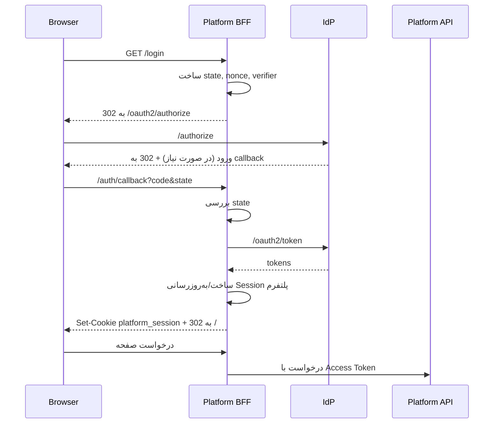

# راهنمای اتصال پلتفرم‌ها

> هر اپلیکیشن دو بخش اتصال دارد: **UI مشترک** به‌صورت میکرو-فرانت‌اند و **بک‌اند** با OIDC. این سند مراحل عملی اتصال، سوشال لاگین هر اپ، مدیریت کاربران و نمونه‌های استک‌های رایج را توضیح می‌دهد.

## 1. پیش‌نیازها

1. اپ یک دامنه HTTPS عمومی و مسیر Callback مشخص دارد.
2. تیم اپ می‌داند کدام نقش‌ها/مجوزها را نیاز دارد.
3. تصمیم گرفته شده است که اپ از الگوی **BFF** (توصیه‌شده) یا SPA/Mobile با PKCE استفاده کند.
4. فریمورک میزبان مشخص است (React برای Module Federation یا Web Component برای سایر فریمورک‌ها).
5. اپ در کنسول Google/Facebook (در صورت نیاز) Credential اختصاصی خودش را دارد.

## 2. ثبت کلاینت در IdP

برای هر پلتفرم یک کلاینت جدا ثبت کنید:

| فیلد | نمونه |
|---|---|
| `clientId` | `platform-a` |
| `type` | `web` / `spa` / `mobile` / `m2m` |
| Redirect URI | `https://platform-a.example.com/auth/callback` |
| Post Logout URI | `https://platform-a.example.com/` |
| Scopes | `openid profile email offline_access` |
| Back-channel Logout URI | `https://platform-a.example.com/auth/backchannel-logout` |

**قواعد:**

- برای هر محیط (توسعه/استیجینگ/تولید) کلاینت یا Redirect URI جدا ثبت کنید.
- از Wildcard در Redirect URI استفاده نکنید.
- Client Secret فقط یک بار نمایش داده می‌شود؛ آن را در Secret Store پلتفرم ذخیره کنید.
- برای SPA/Mobile فقط کلاینت عمومی با PKCE بسازید (بدون Secret).

### 2.1 فعال‌سازی سوشال لاگین برای اپ

1. در کنسول Google/Facebook یک OAuth App با Credential اختصاصی همان اپ بسازید.
2. Callback زیر را ثبت کنید:

```
https://auth.example.com/oauth2/social/{clientId}/{provider}/callback
```

3. Credential را از طریق API یا پنل اپ ذخیره کنید:

```http
PUT /api/v1/clients/platform-a/social-providers/google
Authorization: Bearer <admin access token>
Content-Type: application/json

{
  "clientKey": "....apps.googleusercontent.com",
  "clientSecret": "GOCSPX-...",
  "scopes": ["openid", "email", "profile"],
  "enabled": true
}
```

4. پاسخ شامل `callbackUrl` است؛ همان را در کنسول Provider ثبت کنید.
5. Provider در صفحه ورود همان اپ نمایش داده می‌شود.

**قواعد:**

- Credential هر اپ جداست؛ بین اپ‌ها به اشتراک گذاشته نمی‌شود.
- Secret فقط در سرور IdP و رمزنگاری‌شده است؛ در Frontend یا مخزن اپ قرار نمی‌گیرد.
- برای هر محیط Credential جدا استفاده کنید.
- تغییر Credential نیازمند Step-up و ثبت Audit است.

### 2.2 مدیریت کاربران اپ (Delegated Admin)

- برای ادمین هر اپ نقش `platform-a:user-admin` (یا معادل `<clientId>:user-admin`) با Scope همان کلاینت تخصیص دهید.
- BFF اپ برای مسیرهای مدیریتی Scope `idp.client-admin` را در جریان OIDC درخواست می‌کند؛ IdP آن را فقط برای کاربر دارای مجوز `idp:client-*` صادر می‌کند.
- Admin API هم `aud` و هم Scope را بررسی می‌کند.
- ادمین اپ فقط اعضای همان اپ را می‌بیند و می‌تواند دعوت، غیرفعال‌سازی و تخصیص نقش انجام دهد.
- دعوت عضو:

```http
POST /api/v1/clients/platform-a/members/invite
Authorization: Bearer <delegated admin token>

{
  "email": "user@example.com",
  "roleKeys": ["platform-a:member"],
  "attributes": { "department": "sales" }
}
```

- اگر کاربر مرکزی وجود داشته باشد، فقط Membership ساخته می‌شود.
- `suspended` فقط دسترسی همان اپ را قطع می‌کند.
- نقش‌های قابل تخصیص فقط نقش‌هایی با `client_id = platform-a` هستند.
- ادمین اپ به Client Secret، کلید امضا و داده اپ دیگر دسترسی ندارد.

## 3. اتصال UI (Hosted Login + MFE)

### ورود (Hosted)

- اپ هرگز فرم رمز یا دکمه سوشال را در دامنه خود بازسازی نمی‌کند.
- مسیر `/login` اپ به BFF می‌رود و BFF کاربر را به `https://auth.example.com/oauth2/authorize?...` هدایت می‌کند.
- صفحه ورود با کدبیس مشترک روی دامنه IdP اجرا می‌شود و Providerهای سوشال همان اپ را نشان می‌دهد.

### گزینه A — Module Federation (React، برای ماژول‌های احرازشده)

```tsx
const IdpnAccount = React.lazy(() => import('idpn/AccountApp'));

<IdpnAccount
  clientId="platform-a"
  module="account"
  mode="bff"
  apiBaseUrl="/auth"
  locale="fa"
  onEvent={(event) => handleAuthEvent(event)}
/>
```

### گزینه B — Web Component (سایر فریمورک‌ها)

```html
<on4net-auth
  client-id="platform-a"
  module="user-management"
  mode="bff"
  api-base="/auth"
  locale="fa"
></on4net-auth>
```

### الزامات میزبان

- مسیرهای `/auth/*` در Host به BFF اپ وصل شوند.
- `clientId` از تنظیمات اپ بیاید، نه از ورودی کاربر.
- Remote با نسخه پین‌شده بارگذاری شود.
- در صورت خطای Remote، به صفحه Hosted روی `auth.example.com` هدایت شود.
- CSP برای Origin دامنه IdP و CDN به‌روزرسانی شود.
- هیچ توکنی در رویدادهای MFE دریافت/ارسال نشود (حالت BFF).
- ورود فقط با Redirect به Hosted Auth UI انجام شود؛ ماژول `login` به‌صورت Embedded وجود ندارد.
- برای جزئیات قرارداد Config/Event و نسخه‌بندی: [micro-frontend.md](./micro-frontend.md).

### Design System

- UI مشترک با **shadcn/ui + Tailwind v4** ساخته می‌شود و داخل بسته MFE قرار دارد.
- اپ‌های میزبان نباید shadcn یا Tailwind نسخه خودشان را برای MFE نصب کنند.
- اپ میزبان فقط Theme/Locale را از Config می‌دهد؛ استایل کامپوننت‌ها را Override نمی‌کند.
- جزئیات توکن‌ها، RTL و ایزولاسیون: [design-system.md](./design-system.md).

## 4. الگوی BFF (توصیه‌شده)



**الزامات:**

- `state`، `nonce` و `code_verifier` در Session سمت سرور نگهداری شوند (نه کوکی قابل خواندن).
- توکن‌ها در Session سرور (Redis/DB) ذخیره شوند.
- ورود بدون `state` معتبر رد شود.
- نشست پلتفرم با `HttpOnly; Secure; SameSite=Lax` باشد.
- Refresh Token فقط در سرور باشد.
- مسیر Callback با متد GET/POST مطابق پیکربندی کلاینت باشد.
- `scope` شامل `offline_access` باشد تا Refresh Token صادر شود.

**نمونهٔ اجراشدنی:** [`examples/bff`](../examples/bff/README.md) این الگو را با یک اپلیکیشن کوچک
Fastify پیاده می‌کند (`/login`، `/auth/callback`، `/refresh`، `/logout`) و تست‌های E2E آن در
`e2e/bff/flow.spec.ts` اجرا می‌شوند.

## 5. الگوی SPA / Mobile

- از کتابخانه معتبر OIDC استفاده کنید؛ پیاده‌سازی دستی ممنوع.
- Access Token در حافظه نگهداری شود.
- Refresh Token در SPA در حافظه؛ در موبایل در Keychain/Keystore.
- Silent Renew با `prompt=none` در IFrame ممکن است به‌دلیل محدودیت کوکی Third-Party ناپایدار باشد؛ الگوی BFF ترجیح دارد.
- در موبایل از `ASWebAuthenticationSession` (iOS) و `Custom Tabs` (Android) استفاده شود.
- PKCE اجباری است.

## 6. کتابخانه‌های پیشنهادی

| استک | کتابخانه |
|---|---|
| Node.js / Express | `openid-client` |
| NestJS | `openid-client` (سرویس اختصاصی) |
| Next.js | Auth.js (NextAuth) با Provider سفارشی OIDC |
| React SPA | `oidc-client-ts` + `react-oidc-context` |
| .NET | `Microsoft.AspNetCore.Authentication.OpenIdConnect` |
| Spring Boot | `spring-boot-starter-oauth2-client` |
| Go | `github.com/coreos/go-oidc/v3/oidc` |
| Laravel | `jumbojett/openid-connect-php` یا `socialiteproviders/oidc` |
| Django | `mozilla-django-oidc` |
| Flutter | `openid_client` / `flutter_appauth` |
| React Native | `react-native-app-auth` |

> نسخه‌ها باید Pin و به‌روز نگه داشته شوند. کتابخانه‌های بدون نگهداری فعال استفاده نشوند.

## 7. اعتبارسنجی توکن در API پلتفرم

هر API که توکن IdP را می‌پذیرد باید:

1. JWKS را از `/.well-known/jwks.json` دریافت و Cache کند.
2. امضا را با کلید `kid` بررسی کند.
3. `iss` را با Issuer مورد انتظار مقایسه کند.
4. `aud` را با شناسه API/کلاینت خود مقایسه کند.
5. `exp` و `nbf` را با تحمل حداکثر 60 ثانیه بررسی کند.
6. مجوز لازم را از `permissions` یا از `/userinfo` بگیرد.
7. در صورت خطا، `401` با `WWW-Authenticate: Bearer` برگرداند.

**نمونه بررسی مجوز:**

```
required: platform-a:contact:write
granted: token.permissions.includes(required)
```

- UI می‌تواند دکمه‌ها را مخفی کند، اما **بررسی سروری الزامی** است.
- مجوزها را در کش طولانی‌مدت نگهداری نکنید؛ با عمر Access Token هم‌تراز کنید.

## 8. نقش‌ها و مجوزها در پلتفرم

- منبع حقیقت نقش‌ها و مجوزها IdP است؛ اپ کاتالوگ مجوزهای خودش را در IdP تعریف می‌کند.
- نگاشت نقش به قابلیت‌های UI در پلتفرم انجام می‌شود.
- پروفایل کاربر می‌تواند به‌صورت Cache با کلید `sub` نگهداری شود.
- با تغییر نقش، تا انقضای Access Token ممکن است تغییر اعمال نشود؛ برای اعمال فوری، پلتفرم می‌تواند `/userinfo` را دوباره بخواند یا توکن را تازه کند.
- حذف دسترسی باید در سرور فوراً بررسی شود؛ Claim قدیمی دلیل کافی برای دسترسی نیست در عملیات حساس.
- Claim `membership` شامل وضعیت و ویژگی‌های اختصاصی همان اپ است و در API همان اپ قابل استفاده است.

## 9. خروج

| اقدام | فراخوانی |
|---|---|
| خروج محلی | پاک‌کردن Session پلتفرم؛ بدون تماس با IdP |
| خروج سراسری | `GET /oauth2/logout?id_token_hint=...&post_logout_redirect_uri=...&state=...` |
| دریافت Back-channel | Endpoint پلتفرم که Logout Token را بررسی و Sessionهای مربوط به `sid` را باطل می‌کند |

**Endpoint نمونه Back-channel (شبه‌کد):**

```ts
app.post('/auth/backchannel-logout', async (req, res) => {
  const token = req.body.logout_token;
  const payload = await verifyJwt(token, { algorithms: ['ES256'], audience: CLIENT_ID });
  if (!payload.events?.['http://schemas.openid.net/event/backchannel-logout']) {
    return res.status(400).end();
  }
  await revokeSessionsBySid(payload.sid);
  res.status(200).end();
});
```

- پاسخ سریع (`200`) و پردازش غیرهمگام برای جلوگیری از Timeout.
- بررسی `jti` برای ضد Replay.

## 10. محیط توسعه محلی

| مورد | پیشنهاد |
|---|---|
| دامنه | `localhost` برای IdP و پلتفرم‌ها با پورت‌های مختلف |
| HTTPS | mkcert یا self-signed |
| Redirect URI | `http://localhost:3001/auth/callback` (فقط در حالت توسعه) |
| Cookie | در `localhost` پرچم `Secure` می‌تواند غیرفعال شود (فقط توسعه) |
| داده | کاربر تست و کلاینت توسعه با Seed ایجاد شود |

> تنظیمات «مجاز بودن HTTP» باید فقط در محیط توسعه فعال باشد و در تولید غیرفعال شود.

## 11. چک‌لیست اتصال هر پلتفرم

- [ ] کلاینت در IdP ثبت شده و Redirect URI دقیق است.
- [ ] `state` تولید و بررسی می‌شود.
- [ ] `nonce` تولید و در ID Token بررسی می‌شود.
- [ ] PKCE استفاده می‌شود.
- [ ] توکن‌ها در مرورگر ذخیره نمی‌شوند (BFF) یا در حافظه/Secure Storage هستند.
- [ ] APIها امضا، `iss`، `aud`، `exp` را بررسی می‌کنند.
- [ ] مجوزها در سرور بررسی می‌شوند.
- [ ] مسیر خروج محلی و سراسری مشخص است.
- [ ] Back-channel Logout پیاده‌سازی شده است.
- [ ] Session پلتفرم پس از ابطال در IdP بی‌اعتبار می‌شود.
- [ ] لاگ‌ها توکن/رمز را ثبت نمی‌کنند.
- [ ] رفتار خطاهای `login_required` و `invalid_grant` مشخص است.
- [ ] ساعت سرور با NTP همگام است.
- [ ] تست End-to-End برای ورود، Refresh و خروج وجود دارد.
- [ ] MFE با `clientId` درست و نسخه پین‌شده بارگذاری می‌شود.
- [ ] Fallback به صفحه Hosted تست شده است.
- [ ] CSP برای CDN و دامنه IdP تنظیم شده است.
- [ ] Provider سوشال هر اپ با Credential اختصاصی و Callback دقیق ثبت شده است.
- [ ] ادمین اپ فقط به اعضای همان اپ دسترسی دارد (تست منفی).
- [ ] `suspended` شدن Membership دسترسی همان اپ را قطع می‌کند.
- [ ] رویدادهای MFE هیچ توکنی افشا نمی‌کنند.
- [ ] CSS و Preflight کلاس‌های Host را تغییر نمی‌دهد.
- [ ] RTL فارسی و Theme اپ در Host تست شده است.

## 12. عیب‌یابی رایج

| نشانه | علت احتمالی | راه‌حل |
|---|---|---|
| `redirect_uri_mismatch` | URI دقیقاً ثبت نشده | افزودن URI کامل (Scheme/Host/Port/Path) |
| `invalid_grant` در Callback | Code منقضی/استفاده‌شده | عدم استفاده مجدد؛ شروع مجدد ورود |
| `login_required` با `prompt=none` | نشست IdP وجود ندارد | Redirect به ورود تعاملی |
| `invalid_client` | Secret اشتباه/منقضی | چرخش Secret و به‌روزرسانی Secret Store |
| بعد از خروج همچنان وارد است | خروج محلی بوده | استفاده از خروج سراسری یا Back-channel |
| توکن در API رد می‌شود | `aud`/`iss` نادرست یا ساعت ناهمگام | بررسی تنظیمات و NTP |
| صفحه ورود در IFrame باز نمی‌شود | محدودیت Third-Party Cookie | استفاده از Redirect سطح‌بالا |
| نقش‌ها به‌روز نیستند | کش توکن | Refresh توکن یا خواندن مجدد `/userinfo` |
| MFE بارگذاری نمی‌شود | خطای CDN/نسخه/CSP | بررسی Remote و Fallback Hosted |
| دکمه سوشال نمایش داده نمی‌شود | Provider برای اپ فعال نیست | فعال‌سازی در تنظیمات کلاینت |
| `redirect_uri_mismatch` در سوشال | Callback اختصاصی ثبت نشده | ثبت `.../social/{clientId}/{provider}/callback` |
| `social_email_unverified` | ایمیل Provider تأیید نشده | تأیید ایمیل یا ورود رمز |
| ادمین اپ `403` می‌گیرد | `clientId` مسیر با توکن یکی نیست | استفاده از توکن همان اپ |
| کاربر در یک اپ مسدود است | Membership همان اپ `suspended` است | بررسی وضعیت عضویت |
| داده اپ در توکن اپ دیگر است | خطای Config/Claim | بررسی `aud` و کاتالوگ مجوز |

## 13. قرارداد پشتیبانی بین تیم‌ها

- تغییر در Claimها حداقل 2 نسخه قبل اطلاع داده شود.
- افزودن Claim جدید سازگار است؛ حذف/تغییر نام ناسازگار است.
- هر پلتفرم یک `clientId` پایدار دارد؛ تغییر آن یعنی کلاینت جدید.
- زمان‌بندی چرخش Secret و کلید امضا به تیم‌ها اطلاع داده شود.
