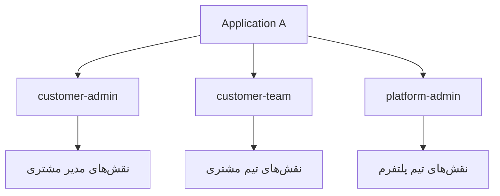
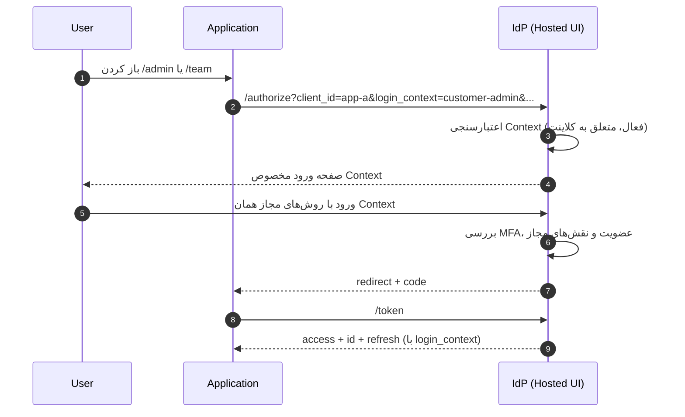

# مدل‌های ورود (Login Contexts) در یک اپلیکیشن

> هر اپلیکیشن می‌تواند چند **مدل ورود** داشته باشد: مدیر مشتری، تیم مشتری، تیم ادمین یا هر چیزی که خودش تعریف می‌کند. هویت کاربر مرکزی است، اما نقش‌ها، روش‌های ورود، سیاست MFA و ظاهر صفحه به‌ازای هر مدل جداگانه تعریف می‌شود.

## 1. مسئله

یک اپلیکیشن ممکن است چند نوع کاربر داشته باشد که نباید با هم قاطی شوند:

| نمونه | چه کسی وارد می‌شود | نقش‌ها |
|---|---|---|
| `customer-admin` | مدیر شرکت مشتری | مدیریت کاربران، صورتحساب، تنظیمات |
| `customer-team` | کارشناسان همان مشتری | عملیات روزمره، بدون تنظیمات |
| `platform-admin` | تیم پلتفرم‌خدمات‌دهنده | مدیریت کل سیستم |
| `support` | تیم پشتیبانی | مشاهده و کمک، بدون تغییر حساس |

اگر همه این‌ها یک صفحه ورود و یک مجموعه نقش داشته باشند:

- مرز دسترسی مبهم می‌شود.
- سیاست MFA و روش ورود برای همه یکسان می‌شود.
- کاربر ممکن است در Context اشتباه وارد شود و نقش بیشتری بگیرد.
- ظاهر صفحه نمی‌تواند برای هر گروه متفاوت باشد.

## 2. مفهوم

**Login Context** یک «درگاه ورود» متعلق به یک کلاینت است:

- به یک `client_id` تعلق دارد و بین اپ‌ها مشترک نیست.
- مجموعه نقش‌های مجاز خودش را دارد.
- روش‌های ورود، سیاست MFA و سیاست ثبت‌نام خودش را دارد.
- ظاهر و متن اختصاصی خودش را دارد.
- در توکن صادرشده به‌صورت Claim `login_context` ظاهر می‌شود.



> Context جایگزین Tenant نیست. Tenant مرز داده سازمانی است؛ Context درگاه ورود **داخل** همان سازمان برای یک اپ است.

## 3. مدل داده

### 3.1 ClientLoginContext

| فیلد | نوع | توضیح |
|---|---|---|
| `id` | UUID | شناسه |
| `client_id` | UUID | اپلیکیشن |
| `key` | string | یکتا در کلاینت، مثل `customer-admin` |
| `name` | string | نام نمایشی |
| `description` | string | توضیح کوتاه برای صفحه انتخاب |
| `status` | enum | `active`, `disabled` |
| `is_default` | boolean | Context پیش‌فرض وقتی پارامتر ارسال نشود |
| `allowed_roles` | text[] | نقش‌های قابل تخصیص در این Context (فقط نقش‌های همان کلاینت) |
| `default_roles` | text[] | نقش‌های خودکار در اولین عضویت |
| `login_methods` | text[] | `password`, `google`, `facebook`, `otp`, `sso` |
| `mfa_policy` | enum | `optional`, `required_admins`, `required_all` |
| `registration_policy` | enum | `invite_only`, `self_service`, `disabled` |
| `allowed_email_domains` | text[]? | محدودیت دامنه |
| `session_idle_ttl` | int | ثانیه |
| `session_absolute_ttl` | int | ثانیه |
| `step_up_required` | boolean | برای عملیات حساس |
| `branding` | jsonb? | لوگو، عنوان و تم مخصوص همین Context |
| `sort_order` | int | ترتیب نمایش |
| `created_at` / `updated_at` | timestamp | — |

**قواعد:**

- یکتایی `(client_id, key)`.
- فقط یک Context می‌تواند `is_default = true` باشد.
- `allowed_roles` فقط می‌تواند نقش‌هایی با `Role.client_id = client_id` را شامل شود؛ نقش سراسری `idp:*` ممنوع است.
- Context غیرفعال در صفحه ورود نمایش داده نمی‌شود و در `/authorize` رد می‌شود.
- حذف Context وقتی عضویت فعال دارد ممنوع است؛ ابتدا باید `disabled` شود.
- `branding` در زمان نوشتن اعتبارسنجی می‌شود: فقط `title` (متن ساده، حداکثر ۱۲۰ کاراکتر)، `logoUrl` (فقط `http(s)`) و `theme` با توکن‌های معتبر؛ کلید ناشناخته یا CSS خام → `422`.

### 3.2 ClientMembership (به‌روزرسانی)

عضویت در سطح `(client, context, user)` تعریف می‌شود تا یک نفر بتواند در یک اپ دو نقش متفاوت داشته باشد.

| فیلد | تغییر |
|---|---|
| `login_context_id` | **جدید** — Context عضویت |
| یکتایی | `(client_id, login_context_id, user_id)` |
| `attributes` | ویژگی‌های اختصاصی همان Context |

نمونه: کاربر `ali` هم `customer-team` است و هم `platform-admin`.

### 3.3 Assignment

- تخصیص نقش همچنان در سطح کاربر/گروه/سرویس است.
- **مالکیت تخصیص:** هر تخصیصی که از مسیر عضویت داده می‌شود، `source_membership_id` همان عضویت را دارد؛ حذف عضویت فقط تخصیص‌های خودش را برمی‌دارد (Cascade). بنابراین دو Context که هر دو یک نقش را در `allowed_roles` دارند، مستقل می‌مانند.
- **فیلتر Context** در زمان صدور توکن اعمال می‌شود: فقط نقش‌هایی که در `allowed_roles` همان Context هستند در Claim می‌آیند.
- نقش‌های خارج از Context نادیده گرفته می‌شوند حتی اگر به کاربر تخصیص داده شده باشند.

### 3.4 Session

- نشست IdP هویت‌محور است (`sid`).
- هر Authorization یک `login_context` دارد.
- `Session` آخرین Context استفاده‌شده را برای نمایش در «نشست‌های فعال» نگه می‌دارد.
- Contextهای با `step_up_required` برای ورود نیازمند احراز هویت تازه‌تر هستند.

### 3.5 Claimهای توکن

```json
{
  "iss": "https://auth.example.com",
  "sub": "e6f0c2a1-...",
  "aud": "app-a",
  "client_id": "app-a",
  "login_context": "customer-admin",
  "roles": ["app-a:customer-admin"],
  "permissions": ["app-a:user:read", "app-a:billing:manage"],
  "membership": {
    "context": "customer-admin",
    "status": "active",
    "attributes": { "companyId": "c-42" }
  },
  "sid": "c1a2...",
  "exp": 1760000600
}
```

- `login_context` الزامی است وقتی کلاینت بیش از یک Context فعال دارد.
- `aud` تغییر نمی‌کند؛ Context زیرمجموعه همان کلاینت است.
- ID Token هم `login_context` را دارد تا UI بتواند حالت درست را نشان دهد.
- Resource Server می‌تواند برای مسیرهای حساس، `login_context` مشخصی را الزام کند.

## 4. جریان ورود



### 4.1 پارامتر `login_context`

| حالت | رفتار |
|---|---|
| ارسال شده و معتبر و متعلق به کلاینت | همان Context استفاده می‌شود |
| ارسال نشده و کلاینت یک Context دارد | Context پیش‌فرض (`is_default`) |
| ارسال نشده و کلاینت چند Context دارد | Context پیش‌فرض؛ اپ باید صریح انتخاب کند |
| Context نامعتبر یا متعلق به کلاینت دیگر | `invalid_request` |
| Context غیرفعال | `invalid_request` |
| کاربر عضو آن Context نیست | `access_denied` |
| نشست معتبر است اما Context جدید نیاز به Step-up دارد | `interaction_required` یا `login_required` |

- `login_context` هرگز از Cookie یا هدر غیرمعتبر خوانده نمی‌شود.
- Context در `state`/Session سمت اپ ذخیره می‌شود، نه در ورودی کاربر.

**رفتار قطعی وقتی پارامتر ارسال نشود (پیاده‌سازی فعلی):**

- اگر کلاینت Context فعال داشته باشد، Context پیش‌فرض (`is_default`) مؤثر است: `allowed_roles`
  نقش‌ها را فیلتر می‌کند، عضویت فعال همان Context لازم است و Claim `login_context` صادر می‌شود
  (`authorize-request.ts` مقدار پیش‌فرض را جایگزین می‌کند).
- فقط کلاینتی که هیچ Context فعالی ندارد مسیر بدون Context را می‌گیرد: عضویت سراسری کلاینت
  (`login_context_id IS NULL`) اعمال می‌شود، نقشی فیلتر نمی‌شود و Claim `login_context` صادر نمی‌شود.
- اپی که چند Context دارد بهتر است `login_context` را صریح بفرستد؛ Hosted UI در نبود پارامتر صفحه
  انتخاب را نشان می‌دهد و انتخاب کاربر را در `return_to` می‌نویسد.
- در `/token`، برای هر Code/Refresh Token دارای `login_context`، فعال‌بودن Context و
  `active` بودن Membership همان Context دوباره بررسی می‌شود. Context غیرفعال، Membership
  حذف‌شده/`invited` یا `suspended` توکن جدید نمی‌دهد و Refresh Tokenهای همان خانواده باطل
  می‌شوند. درخواست Refresh نمی‌تواند Context را عوض کند؛ مقدار توکن ذخیره‌شده مرجع است.

### 4.2 صفحه انتخاب Context

- اگر اپ `login_context` نفرستد و چند Context فعال داشته باشد، Hosted UI صفحه انتخاب نمایش می‌دهد.
- این صفحه فقط Contextهایی را نشان می‌دهد که **برای همان کلاینت** فعال‌اند.
- متن و ترتیب از `sort_order` و `branding` هر Context می‌آید.
- انتخاب کاربر در `state` همان درخواست باقی می‌ماند.

**رفتار پیاده‌سازی‌شده Hosted UI (پیاده‌سازی فعلی):**

- Context مؤثر به این ترتیب انتخاب می‌شود: `login_context` ارسالی اپ ← انتخاب کاربر در صفحه ←
  `defaultLoginContext` (همان `is_default` سرور) ← اولین Context فعال.
- Context پیش‌فرض از قبل انتخاب شده است؛ کلاینت تک‌Context هیچ انتخابگری نشان نمی‌دهد.
- انتخاب کاربر فقط `login_context` را به همان URL اصلی `/oauth2/authorize` (`return_to`) اضافه
  می‌کند؛ `state`، `nonce`، `code_challenge` و `login_hint` دست‌نخورده می‌مانند و URL صفحه هم
  (`login_context=`) قابل Deep-link است.
- Context مؤثر با `POST /api/v1/login` هم ارسال می‌شود تا سیاست MFA همان Context اعمال شود؛
  نهایتاً `/authorize` و `/token` مرجع اعتبارسنجی هستند.
- Context نامعتبر/غیرفعال هرگز اعمال نمی‌شود؛ انتخابگر با پیام «در دسترس نیست» نمایش داده
  می‌شود و Context پیش‌فرض انتخاب می‌ماند.
- فقط روش‌های ورود همان Context نمایش داده می‌شود (`login_methods`): فرم رمز عبور و
  Providerهای سوشال فیلتر می‌شوند. صفحه انتخاب فقط نمایش است؛ مرز دسترسی سمت سرور اعمال می‌شود.
- تم Context روی تم کلاینت اعمال می‌شود (فقط توکن‌های معتبر تم؛ بدون CSS خام) و رویداد
  `context:changed` پس از تغییر Context منتشر می‌شود.
- جریان سوشال به `login_request` سمت سرور مقید است؛ تغییر Context در Hosted UI آن را بازنویسی
  نمی‌کند، پس برای Binding درست، اپ باید `login_context` را از مسیر خودش در `/authorize` بفرستد.

## 5. نقش‌ها و مجوزها

محاسبه مجوز مؤثر برای توکن:

```
context = login_context درخواست (یا default)
roles = نقش‌های تخصیص‌یافته به کاربر
        ∩ allowed_roles(context)
permissions = ∪ permissions(roles)
filter: permission.client_id is null OR permission.client_id = context.client_id
```

- نقش خارج از `allowed_roles` در توکن نمی‌آید.
- نقش `idp:*` هرگز در Context اپلیکیشنی قرار نمی‌گیرد.
- `default_roles` در اولین عضویت همان Context تخصیص می‌یابد.
- نقش‌های تخصیص‌یافته از مسیر یک عضویت به همان عضویت تعلق دارند (`assignments.source_membership_id`)؛ اگر دو Context از یک اپ هر دو یک نقش را مجاز بدانند، حذف عضویت یکی، نقش Context دیگر را لغو **نمی‌کند**. `PUT …/roles` هم فقط تخصیص‌های همان عضویت را جایگزین می‌کند.
- تغییر `allowed_roles` بلافاصله روی توکن‌های جدید اثر دارد؛ توکن‌های قبلی تا انقضا معتبرند.
- برای اعمال فوری، اپ می‌تواند `/userinfo` را دوباره بخواند یا توکن را تازه کند.

## 6. امنیت

| تهدید | کنترل |
|---|---|
| ارتقای سطح دسترسی با انتخاب Context دیگر | `allowed_roles` محدود به نقش‌های همان کلاینت؛ فیلتر در زمان صدور توکن |
| Context Confusion (توکن ادمین در مسیر مشتری) | Claim `login_context` و الزام آن در Resource Server برای مسیرهای حساس |
| استفاده از Context اپ دیگر | اعتبارسنجی سروری `client_id` + `login_context` |
| دور زدن MFA با Context ضعیف‌تر | `mfa_policy` هر Context؛ مسیرهای حساس Context با MFA اجباری |
| ورود به Context بدون عضویت | بررسی Membership فعال |
| Context غیرفعال همچنان کار می‌کند | بررسی `status` در authorize و token |
| نشت لیست Contextها | Public Config فقط Contextهای فعال و حداقل داده |

**قواعد سخت:**

- `login_context` ورودی کاربر نیست؛ از پارامتر معتبر درخواست می‌آید و سمت سرور اعتبارسنجی می‌شود.
- Context هرگز نمی‌تواند نقش سراسری یا دسترسی اپ دیگر بدهد.
- Context با `step_up_required` بدون احراز هویت تازه توکن صادر نمی‌کند.
- همه ورودها و ردها با `client_id` و `login_context` در Audit ثبت می‌شوند.
- تغییر `allowed_roles`، `mfa_policy` یا `login_methods` نیازمند Step-up و Audit است.

## 7. قرارداد API

### 7.1 Public Config

```json
{
  "clientId": "app-a",
  "loginContexts": [
    {
      "key": "customer-admin",
      "name": "ورود مدیر مشتری",
      "description": "مدیریت کاربران و صورتحساب",
      "methods": ["password", "google"],
      "mfaPolicy": "required_all",
      "registrationPolicy": "invite_only",
      "branding": {
        "title": "پنل مدیر مشتری",
        "logoUrl": "https://app-a.../admin.svg",
        "theme": { "primary": "#0f766e" }
      }
    },
    {
      "key": "customer-team",
      "name": "ورود تیم مشتری",
      "methods": ["password"],
      "mfaPolicy": "optional"
    }
  ],
  "defaultLoginContext": "customer-team"
}
```

- فقط Contextهای `active`.
- هیچ `allowed_roles` یا داده حساسی منتشر نمی‌شود.
- `branding` فقط شامل `title` (متن ساده)، `logoUrl` (فقط `http(s)`) و `theme` با توکن‌های
  معتبر تم است؛ CSS خام، فیلد ناشناخته یا مقدار نامعتبر حذف می‌شود.

### 7.2 Admin API

| متد | مسیر | مجوز |
|---|---|---|
| GET | `/api/v1/clients/{clientId}/login-contexts` | `idp:client-context:read` |
| POST | `/api/v1/clients/{clientId}/login-contexts` | `idp:client-context:write` |
| GET | `/api/v1/clients/{clientId}/login-contexts/{key}` | `idp:client-context:read` |
| PATCH | `/api/v1/clients/{clientId}/login-contexts/{key}` | `idp:client-context:write` |
| POST | `/api/v1/clients/{clientId}/login-contexts/{key}/disable` | `idp:client-context:write` |
| POST | `/api/v1/clients/{clientId}/login-contexts/{key}/enable` | `idp:client-context:write` + Step-up |
| DELETE | `/api/v1/clients/{clientId}/login-contexts/{key}` | `idp:client-context:write` |

- `disable` فقط `status` را `disabled` می‌کند؛ عضویت‌ها و ردیف Context می‌مانند.
- `enable` همان Context را به `active` برمی‌گرداند (idempotent)، Audit با `client.context.enabled` ثبت می‌شود و نیازمند احراز هویت تازه است. فقط ارتقای یک Context غیرفعال به پیش‌فرض ممنوع است؛ ابتدا آن را فعال کنید.
- رد شدن هر درخواست (401/403) با `client.context.denied` و `result=failure` در Audit ثبت می‌شود.

**ایجاد:**

```json
{
  "key": "customer-admin",
  "name": "ورود مدیر مشتری",
  "allowedRoles": ["app-a:customer-admin"],
  "defaultRoles": ["app-a:customer-admin"],
  "loginMethods": ["password", "google"],
  "mfaPolicy": "required_all",
  "registrationPolicy": "invite_only",
  "stepUpRequired": true,
  "isDefault": false,
  "sortOrder": 1
}
```

### 7.3 عضویت

| متد | مسیر | مجوز | توضیح |
|---|---|---|---|
| GET | `/api/v1/clients/{clientId}/login-contexts/{key}/members` | `idp:client-member:read` | اعضای همان Context |
| POST | `/api/v1/clients/{clientId}/login-contexts/{key}/members/invite` | `idp:client-member:invite` | دعوت به Context |
| GET | `/api/v1/clients/{clientId}/login-contexts/{key}/members/{userId}` | `idp:client-member:read` | عضویت همان Context |
| PATCH | `/api/v1/clients/{clientId}/login-contexts/{key}/members/{userId}` | `idp:client-member:write` | تغییر وضعیت/ویژگی |
| DELETE | `/api/v1/clients/{clientId}/login-contexts/{key}/members/{userId}` | `idp:client-member:write` | حذف عضویت همان Context |
| PUT | `/api/v1/clients/{clientId}/login-contexts/{key}/members/{userId}/roles` | `idp:client-role:assign` + Step-up | جایگزینی نقش‌های همین عضویت |
| POST | `/api/v1/clients/{clientId}/login-contexts/{key}/members/{userId}/invite/resend` | `idp:client-member:invite` | ارسال دوباره دعوت Context |

- `suspended` فقط همان Context را قطع می‌کند.
- ادمین Context فقط به همان Context دسترسی دارد.
- `PUT …/roles` تخصیص‌های همان عضویت را جایگزین می‌کند؛ نقش مشترک با Context دیگر باقی می‌ماند.
- `POST …/invite/resend` فقط برای عضویت `invited` است؛ محدودیت ۵ بار در ساعت به‌ازای همان عضویت Context، و `202` با `delivery` برمی‌گرداند.
- خطاها: `404` برای Context یا عضویت ناموجود در همان Context، `409` برای عضویت تکراری یا دعوت غیرقابل‌ارسال، `422` برای نقش خارج از `allowed_roles` یا داده نامعتبر، `403` برای Step-up نامعتبر.

## 8. ادمین واگذارشده (Delegated Admin)

| نقش | دامنه |
|---|---|
| `app-a:context-admin-customer-admin` | مدیریت اعضای Context `customer-admin` |
| `app-a:context-admin-customer-team` | مدیریت اعضای Context `customer-team` |

- ادمین Context نمی‌تواند Context بسازد، حذف کند یا `allowed_roles` را تغییر دهد (مگر مجوز صریح داشته باشد).
- تغییر سیاست MFA یا روش‌های ورود نیازمند Step-up است.
- همه اقدامات با `client_id` و `login_context` در Audit ثبت می‌شود.

## 9. سناریوهای لبه

| سناریو | رفتار |
|---|---|
| کاربر عضو دو Context از یک اپ | دو Membership مستقل؛ توکن هر ورود فقط نقش‌های همان Context |
| Context حذف‌شده در Session قبلی | توکن جدید صادر نمی‌شود؛ خطای `access_denied` |
| تغییر `allowed_roles` هنگام نشست فعال | توکن فعلی تا انقضا معتبر؛ توکن بعدی فیلترشده |
| Context با `mfa_policy=required_all` و کاربر بدون MFA | ورود به مرحله ثبت/تأیید MFA هدایت می‌شود |
| اپ بدون Context و بدون `login_context` | `invalid_request` (وقتی بیش از یک Context تعریف شده) |
| ورود سوشال که Provider آن در Context فعال نیست | دکمه نمایش داده نمی‌شود؛ درخواست مستقیم رد می‌شود |
| ادمین اپ Context دیگری را در URL دستکاری می‌کند | `403` و Audit |

## 10. تست

| ID | تست |
|---|---|
| CTX-001 | Context نامعتبر/متعلق به اپ دیگر در authorize رد می‌شود |
| CTX-002 | Context غیرفعال رد می‌شود |
| CTX-003 | کاربر بدون عضویت `access_denied` می‌گیرد |
| CTX-004 | توکن فقط نقش‌های `allowed_roles` را دارد |
| CTX-005 | نقش `idp:*` در Context اپ ظاهر نمی‌شود |
| CTX-006 | یک کاربر دو Context دارد و نقش‌ها اشتباه نمی‌شوند |
| CTX-007 | تغییر Context نیازمند Step-up در Context حساس |
| CTX-008 | ادمین Context به Context دیگر دسترسی ندارد |
| CTX-009 | صفحه انتخاب Context فقط Contextهای فعال را نشان می‌دهد |
| CTX-010 | Resource Server می‌تواند `login_context` را الزام کند |
| CTX-011 | Context حذف/غیرفعال، توکن جدید نمی‌دهد |
| CTX-012 | Audit برای ورود/رد/تغییر Context |

## 11. چک‌لیست پذیرش

- [ ] هر اپ می‌تواند چند Context تعریف کند.
- [ ] Contextها فقط متعلق به همان `client_id` هستند.
- [ ] صفحه ورود بر اساس Context روش‌های مجاز و برند خودش را نشان می‌دهد.
- [ ] توکن `login_context` دارد و نقش‌ها فیلتر شده‌اند.
- [ ] نقش سراسری در Context اپلیکیشنی صادر نمی‌شود.
- [ ] عضویت در سطح Context مدیریت می‌شود.
- [ ] ادمین Context فقط به Context خودش دسترسی دارد.
- [ ] MFA و Step-up به‌ازای Context اعمال می‌شود.
- [ ] تغییرات Context Audit می‌شوند.
- [ ] تست‌های CTX-001 تا CTX-012 سبز هستند.
