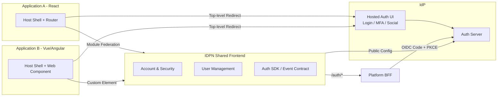
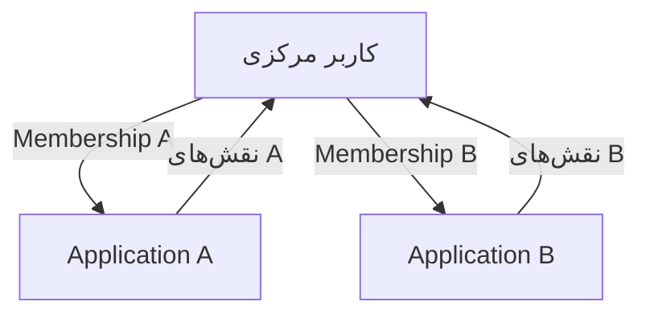

# معماری میکرو-فرانت‌اند

> هدف: یک رابط احراز هویت و مدیریت کاربری مشترک که هر اپلیکیشن آن را مصرف می‌کند و دیگر UI مدیریت کاربری خود را از نو نمی‌نویسد؛ در عین حال هر اپلیکیشن فقط کاربران و نقش‌های خودش را می‌بیند. صفحه ورود روی دامنه IdP میزبانی می‌شود (با همان کدبیس مشترک) و ماژول‌های حساب کاربری و مدیریت کاربران به‌صورت میکرو-فرانت‌اند داخل اپ‌ها Mount می‌شوند.

## 1. اصول

1. **یک پیاده‌سازی، چند اپلیکیشن:** Login، پروفایل، امنیت حساب، مدیریت نشست و مدیریت کاربران یک بار ساخته می‌شود.
2. **Login روی دامنه IdP:** فرم رمز و سوشال در دامنه `auth` اجرا می‌شود تا کوکی نشست و SSO امن بماند؛ اپ فقط کاربر را با Redirect سطح‌بالا به آن می‌فرستد.
3. **Scoped per app:** ماژول مدیریت کاربران با `clientId` بارگذاری می‌شود و فقط اعضای همان اپلیکیشن را نشان می‌دهد.
4. **Config-driven، نه Fork:** تفاوت اپلیکیشن‌ها با تنظیمات (تم، لوگو، زبان، Providerهای سوشال، سیاست ثبت‌نام) اعمال می‌شود، نه کپی کد.
5. **Framework-agnostic:** اپلیکیشن‌های React از Module Federation و بقیه از Web Component استفاده می‌کنند.
6. **BFF-first:** در حالت پیش‌فرض توکن به جاوااسکریپت میزبان داده نمی‌شود.
7. **Graceful fallback:** اگر Remote بارگذاری نشد، کاربر به صفحه Hosted روی دامنه IdP هدایت می‌شود.
8. **قرارداد نسخه‌دار:** تغییرات ناسازگار بدون نسخه جدید منتشر نمی‌شود.

## 2. نمای کلی



## 3. ماژول‌ها

| ماژول | محل اجرا | محتوا | دسترسی |
|---|---|---|---|
| `hosted-auth` | `auth.example.com` | ورود با رمز، TOTP، دکمه‌های سوشال، بازیابی رمز، Consent | عمومی |
| `account` | Embedded در اپ | پروفایل، تغییر رمز، MFA، نشست‌های فعال، حذف حساب | کاربر واردشده |
| `user-management` | Embedded در اپ | فهرست اعضای اپ، دعوت، وضعیت، نقش‌های همان اپ | ادمین اپ / ادمین سراسری |
| `admin` | جدا (`admin.example.com`) | مدیریت کلاینت‌ها، نقش‌های سراسری، کلیدها، Audit | ادمین سراسری |

> ماژول `admin` عمداً داخل MFE اپلیکیشن‌ها قرار نمی‌گیرد؛ سطح دسترسی آن بالاتر است و روی دامنه مستقل با MFA اجباری اجرا می‌شود. `hosted-auth` نیز داخل اپ Mount نمی‌شود و فقط با Redirect سطح‌بالا باز می‌شود.

## 4. حالت‌های تحویل

### 4.1 Hosted Auth UI (ورود — اصلی)

- آدرس: `https://auth.example.com/oauth2/authorize?...`
- همان کامپوننت‌های مشترک React در یک Shell سبک روی دامنه IdP بارگذاری می‌شوند.
- ورود رمز، MFA، سوشال و بازیابی رمز اینجا انجام می‌شود.
- دلیل: کوکی نشست IdP، SSO، جلوگیری از محدودیت Third-Party Cookie و عدم افشای توکن به اپ.
- اپ‌ها نباید فرم رمز یا دکمه سوشال را داخل دامنه خودشان بازسازی کنند؛ فقط Redirect می‌کنند.

### 4.2 Module Federation (ماژول‌های احرازشده در React)

```ts
remotes: {
  idpn: 'idpn@https://cdn.example.com/idpn-mfe/1.4.0/remoteEntry.js',
}
```

```tsx
const UserManagement = React.lazy(() => import('idpn/UserManagement'));

<UserManagement clientId="app-a" locale="fa" mode="bff" />
```

- `react`, `react-dom` و `react-router` به‌صورت **Singleton** به اشتراک گذاشته می‌شوند.
- نسخه Major در URL Remote پین می‌شود.
- Remote در CDN با Assetهای Immutable منتشر می‌شود.

### 4.3 Web Component (هر فریمورکی)

```html
<on4net-auth
  client-id="app-b"
  module="user-management"
  locale="fa"
  mode="bff"
  api-base="https://app-b.example.com/auth"
></on4net-auth>
```

- Shadow DOM برای جلوگیری از تداخل CSS.
- رویدادها با `CustomEvent` و `detail` منتشر می‌شوند.
- برای Vue/Angular/legacy یا اپ‌هایی که نمی‌خواهند React را Share کنند.

### 4.4 Hosted Fallback

- اگر Remote بارگذاری نشد یا اپ موبایل بود: `https://auth.example.com/account` یا `https://auth.example.com/oauth2/authorize?...`
- در این حالت `frame-ancestors 'none'` است و داخل iframe قرار نمی‌گیرد.

## 5. قرارداد تنظیمات (Config Contract)

```ts
export interface IdpnMfeConfig {
  clientId: string;
  mode: 'bff' | 'spa';
  apiBaseUrl: string;          // در BFF: مسیر /auth خود اپ
  loginUrl?: string;           // آدرس Hosted Auth برای Redirect
  locale?: 'fa-IR' | 'en-US' | string;
  locales?: {
    default: string;
    supported: string[];
    dir: Record<string, 'rtl' | 'ltr'>;
  };
  loginContext?: string;       // مدل ورود فعال همان اپ
  theme?: IdpnThemeTokens;     // ۱۲ کلید رنگ + radius + fontFamily + dark (docs/design-system.md 4)
  module: 'account' | 'user-management';
  basename?: string;
  features?: {
    selfServiceRegistration?: boolean;
    userManagement?: boolean;
    mfa?: boolean;
  };
  onEvent?: (event: IdpnEvent) => void;
}
```

**قواعد:**

- `clientId` فقط از تنظیمات میزبان می‌آید و قابل تغییر در Runtime توسط کاربر نیست.
- ماژول `login` به‌صورت Embedded وجود ندارد؛ ورود همیشه با Redirect به `loginUrl` انجام می‌شود.
- `loginContext` از مسیر اپ (مثلاً `/admin`) تعیین می‌شود، نه از ورودی خام کاربر.
- `locale` و `locales` باید با Public Config همان کلاینت هم‌خوان باشند؛ مقدار نامعتبر به پیش‌فرض سقوط می‌کند.
- `mode=spa` فقط برای اپ‌های کاملاً مورد اعتماد و ترجیحاً Monorepo.
- MFE نباید Secret یا Client Secret دریافت کند.
- تنظیمات عمومی از `GET /api/v1/clients/{clientId}/public-config` خوانده می‌شود.

## 6. قرارداد رویدادها

```ts
export type IdpnEvent =
  | { type: 'auth:login'; user: PublicUser; loginContext: string }
  | { type: 'auth:logout'; reason: 'local' | 'global' | 'expired' }
  | { type: 'auth:error'; code: string }
  | { type: 'profile:updated'; user: PublicUser }
  | { type: 'locale:changed'; locale: string; dir: 'rtl' | 'ltr' }
  | { type: 'context:changed'; loginContext: string }
  | { type: 'navigation:request'; to: string };
```

- **هیچ توکنی در `detail` رویدادها قرار نمی‌گیرد.**
- میزبان می‌تواند با `navigation:request` مسیر خودش را عوض کند.
- برای Web Component، رویدادها با `bubbles: true, composed: true` منتشر می‌شوند.
- در حالت iframe (در صورت استفاده)، `postMessage` فقط با Origin Allowlist و بررسی `event.origin` پذیرفته می‌شود.

## 7. جداسازی و تداخل

| موضوع | راهکار |
|---|---|
| CSS | shadcn/ui + Tailwind v4؛ Scope کردن CSS داخل `.idpn-root`، غیرفعال‌کردن Preflight بیرونی، و Shadow DOM در Web Component |
| Radix Portal | `container` به یک گره داخل ریشه MFE؛ جلوگیری از رندر Portal در `body` میزبان |
| Routing | Router داخلی با `basename`؛ Host مالک مسیر بالادست است |
| State | State داخلی MFE؛ هیچ Global Store میزبان خوانده/نوشته نمی‌شود |
| React Version | Singleton در Module Federation؛ نسخه React 19 در Host و Remote یکسان |
| Global Error | Error Boundary داخلی؛ خطا به رویداد `auth:error` تبدیل می‌شود |
| Font/Icon | از Design Token و فونت خود MFE (Vazirmatn برای `fa-IR`)؛ وابستگی به فونت میزبان ممنوع |
| RTL/LTR | `DirectionProvider` رادیکس + `dir` داخل ریشه MFE بر اساس Locale همان اپ؛ Audit کامل در [design-system.md](./design-system.md) |
| Locale | Locale از Config میزبان/Public Config؛ MFE زبان Host را نمی‌خواند و تغییر نمی‌دهد |
| Login Context | `loginContext` فقط برای نمایش و درخواست‌های مجاز؛ مرز دسترسی در سرور اعمال می‌شود |

## 8. مدیریت کاربری هر اپلیکیشن

- `user-management` همیشه با `clientId` رندر می‌شود.
- اگر اپ چند Login Context دارد، ماژول با `loginContext` فعال رندر می‌شود و فقط اعضای همان Context را نشان می‌دهد.
- API مورد استفاده: `/api/v1/clients/{clientId}/login-contexts/{key}/members`.
  تا زمانی که Admin API مربوط به Context تکمیل نشده، پیاده‌سازی فعلی از
  `/api/v1/clients/{clientId}/members` (عضویت پیش‌فرض همان اپ) استفاده می‌کند.
- BFF اپ برای این مسیرها Scope `idp.client-admin` را در جریان OIDC درخواست می‌کند؛ این Scope فقط برای ادمین همان اپ صادر می‌شود.
- ادمین اپ فقط اعضای همان اپ را می‌بیند و می‌تواند:
  - دعوت کاربر
  - فعال/غیرفعال‌کردن عضویت در اپ
  - تخصیص نقش‌های همان اپ
  - مشاهده نشست‌های همان اپ (اختیاری)
- ادمین اپ **نمی‌تواند** نقش سراسری، کلاینت دیگر، Secret یا کلید را تغییر دهد.
- ادمین Context فقط اعضای همان Context را می‌بیند و `allowed_roles` را تغییر نمی‌دهد.
- داده‌های اختصاصی اپ در `ClientMembership.attributes` نگهداری می‌شود و در توکن همان اپ قرار می‌گیرد.
- کاربر می‌تواند در چند اپ عضو باشد؛ هویت و رمز عبور یکی است.

**رابط ماژول (پیاده‌سازی فعلی):**

```tsx
<UserManagement
  clientId="app-a"          // الزامی؛ از Config میزبان، هرگز ورودی کاربر
  apiBaseUrl="/auth"        // BFF همان اپ؛ پیش‌فرض same-origin
  getAccessToken={() => token} // فقط حالت SPA؛ توکن فقط در حافظه
  locale="fa-IR"
  dir="rtl"
  pageSize={10}
  onEvent={(event) => {}}   // فقط auth:error با code؛ بدون توکن
/>
```

```html
<on4net-idpn-user-management
  client-id="app-a"
  api-base="/auth"
  locale="fa-IR"
  dir="rtl"
  page-size="10"
></on4net-idpn-user-management>
```

- در حالت پیش‌فرض (BFF) هیچ توکنی در مرورگر نگه‌داری نمی‌شود؛ کوکی نشست BFF
  درخواست‌های `/api/v1/clients/{clientId}/…` را احراز می‌کند.
- در حالت SPA، توکن از طریق getter در حافظه خوانده می‌شود و در `Authorization` قرار می‌گیرد؛
  هیچ‌جا persist نمی‌شود و در رویدادها نیز قرار نمی‌گیرد.
- ماژول فقط `GET/POST/PATCH/PUT` روی مسیرهای همان `clientId` صدا می‌زند و
  `clientId` مسیر از Config می‌آید، نه از State یا Query کاربر.
- حالت‌های Loading/Error/Empty و صفحه‌بندی پیاده‌سازی شده‌اند؛ تغییر نقش نیازمند
  Step-up سروری است و در صورت `403` پیام خطا در همان دیالوگ نمایش داده می‌شود.
- `loginContext` پس از تکمیل Admin API آن (کارت #61) به همین رابط اضافه می‌شود؛
  در نسخه فعلی، عضویت پیش‌فرض اپ نمایش داده می‌شود.



## 9. سوشال لاگین با کلید هر اپلیکیشن

- هر اپلیکیشن می‌تواند Providerهای خودش (Google، Facebook و…) را با **Client ID/Secret اختصاصی** فعال کند.
- تنظیمات در `ClientSocialProvider` ذخیره و Secret آن رمزنگاری می‌شود.
- صفحه ورود بر اساس `client_id` فقط Providerهای فعال همان اپ را نشان می‌دهد.
- Callback اختصاصی هر اپ/Provider:

```
https://auth.example.com/oauth2/social/{clientId}/{provider}/callback
```

- این URL باید در کنسول Google/Facebook همان اپ ثبت شود.
- جزئیات جریان در [auth-flows.md](./auth-flows.md#9-ورود-اجتماعی-social-login).

## 10. نسخه‌بندی و انتشار

| موضوع | سیاست |
|---|---|
| نسخه Remote | Semantic Versioning |
| URL | `https://cdn.example.com/idpn-mfe/{version}/remoteEntry.js` |
| Manifest | `https://cdn.example.com/idpn-mfe/manifest.json` برای کشف نسخه سازگار |
| پین نسخه | Host حداقل تا Major را پین می‌کند |
| تغییر ناسازگار | Major جدید + مهلت مهاجرت |
| Deprecation | حداقل دو نسخه Minor قبل از حذف |
| انتشار | مستقل از اپلیکیشن‌ها؛ بدون نیاز به Deploy مجدد Host |
| Rollback | نسخه قبلی در CDN نگهداری می‌شود |

## 11. کارایی

| شاخص | هدف |
|---|---|
| حجم اولیه Hosted Auth UI | ≤ 150KB gzip |
| LCP صفحه ورود | ≤ 1.5s در 3G سریع |
| بارگذاری ماژول مدیریت کاربران | Lazy و فقط هنگام ورود به مسیر |
| Prefetch | Remote پس از ورود صفحه اصلی به‌صورت Idle |
| Cache | Assetهای Immutable با هش محتوا |

## 12. امنیت MFE

- Remote فقط از Origin مورد اعتماد بارگذاری می‌شود (CSP `script-src` و `connect-src`).
- `IDPN_REMOTE_ENTRY` قبل از ساخت Config اعتبارسنجی می‌شود: یا مسیر same-origin با یک `/` ابتدایی، یا URL با `https` که Origin آن در `IDPN_REMOTE_ORIGINS` Allowlist شده باشد؛ در غیر این صورت Build/Dev Server با خطای صریح متوقف می‌شود. فقط همان Origin در CSP مجاز می‌شود.
- مسیرهای `/api` و `/auth` از میزبان پراکسی می‌شوند (`IDPN_IDP_ORIGIN`)، بنابراین کوکی BFF first-party می‌ماند و فراخوانی‌های `/auth/*` بومی ۴۰۴ نمی‌شوند.
- مقادیر `api-base` و `loginUrl` با یک قاعده مشترک (`isSafeTarget`) بررسی می‌شوند: `//host`، `/\host` و `\\host` (که مرورگر مانند `//` تفسیر می‌کند) رد می‌شوند.
- فرم رمز یا دکمه سوشال داخل دامنه اپ ساخته نمی‌شود؛ ورود فقط با Redirect سطح‌بالا به Hosted Auth UI انجام می‌شود.
- هیچ توکنی در `localStorage` یا رویدادهای MFE قرار نمی‌گیرد.
- در حالت BFF، MFE فقط با Cookie نشست اپ و Endpointهای `/auth/*` کار می‌کند.
- در حالت SPA، توکن در حافظه است و میزبان از نظر فنی می‌تواند به آن دسترسی داشته باشد؛ بنابراین SPA فقط برای اپ‌های مورد اعتماد.
- `postMessage` فقط با Origin مجاز و Schema مشخص.
- محتوای Remote با HTTPS و Asset Immutable سرو می‌شود؛ SRI کامل با Module Federation محدود است، بنابراین Origin و نسخه باید کنترل شوند.
- صفحه Hosted در iframe قرار نمی‌گیرد (`frame-ancestors 'none'`).
- ورودی‌ها با Schema اعتبارسنجی می‌شوند؛ از `dangerouslySetInnerHTML` استفاده نمی‌شود.
- CSP Host باید Origin دامنه IdP و CDN را Allowlist کند.
- وابستگی‌های shadcn/Tailwind/Radix Pin و در CI اسکن شوند؛ جزئیات در [design-system.md](./design-system.md#10-supply-chain).
- Preflight و Reset نباید از MFE به Host نشت کند؛ این یک الزام امنیتی/UX است.

## 13. تست میکرو-فرانت‌اند

- Unit: کامپوننت‌ها و هوک‌ها با React Testing Library.
- Integration: Mount در Host Fixture با `clientId`های مختلف.
- Contract: بررسی Config/Event Schema و سازگاری نسخه.
- E2E: Mount در دو اپ نمونه و اجرای جریان ورود/SSO/مدیریت کاربر.
- Web Component: تست در Host غیر-React (Vue/Angular/HTML ساده).
- Accessibility: axe-core و بررسی RTL.
- Visual Regression: Playwright Screenshot برای Light/Dark و RTL/LTR.
- shadcn/ui: تست کامپوننت‌های مصرفی، Portal، Form و Table.
- Isolation: Host با Tailwind مستقل و بررسی عدم نشت CSS.

جزئیات در [testing.md](./testing.md).

## 14. چک‌لیست اتصال میزبان

- [ ] `clientId` اپ در IdP ثبت شده است.
- [ ] Origin اپ در `allowed_origins` کلاینت ثبت شده است.
- [ ] Remote با نسخه پین‌شده بارگذاری می‌شود.
- [ ] React/ReactDOM به‌صورت Singleton Share می‌شوند (در حالت Module Federation).
- [ ] مسیر `/auth/*` در Host تعریف شده و به MFE می‌رسد.
- [ ] ورود همیشه با Redirect به Hosted Auth UI انجام می‌شود و فرم رمز در دامنه اپ نیست.
- [ ] BFF مسیرهای `/auth/*` را به IdP وصل می‌کند.
- [ ] Theme و Locale از طریق Config ارسال می‌شوند.
- [ ] رویدادها فقط برای به‌روزرسانی UI میزبان استفاده می‌شوند.
- [ ] Fallback به صفحه Hosted تست شده است.
- [ ] CSP Host برای CDN و IdP به‌روزرسانی شده است.
- [ ] تست Mount/Unmount بدون نشتی حافظه یا Listener تکراری پاس می‌شود.
- [ ] نسخه shadcn/ui و Tailwind Pin شده و در `UPSTREAM.md` ثبت است.
- [ ] CSS و Preflight به Host نشت نمی‌کند.
- [ ] Radix Portalها داخل ریشه MFE رندر می‌شوند.
- [ ] RTL فارسی با `DirectionProvider` تست شده است.
- [ ] زبان و متن‌های اپ از Public Config/Override همان کلاینت خوانده می‌شود.
- [ ] `loginContext` از مسیر اپ تعیین می‌شود و با توکن هم‌خوان است.
- [ ] axe بدون خطای Critical/Serious است.
- [ ] تست Visual برای Light/Dark و RTL/LTR وجود دارد.
