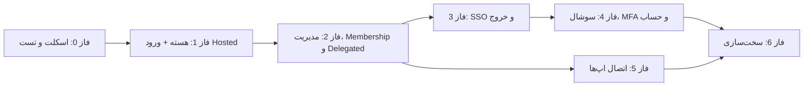

# نقشه راه اجرا

> این سند فازبندی، تحویل‌دادنی‌ها، معیارهای پذیرش و ریسک‌ها را تعریف می‌کند. پس از تأیید مستندات، تسک‌های اجرایی بر همین اساس ثبت می‌شوند.

## 1. تعریف MVP

MVP زمانی آماده است که:

1. یک کاربر بتواند با ایمیل/رمز در IdP وارد شود.
2. میکرو-فرانت‌اند ورود در یک اپ نمونه Mount شود و جریان ورود را کامل کند.
3. یک اپ نمونه با Authorization Code + PKCE وارد شود و توکن بگیرد.
4. SSO بین دو اپ نمونه کار کند.
5. ادمین بتواند کاربر، کلاینت و Membership بسازد و نقش تخصیص دهد.
6. ادمین هر اپ فقط اعضای همان اپ را ببیند.
7. نقش/مجوز و `membership` در Access Token همان کلاینت درست صادر شود.
8. ورود Google برای یک اپ با Credential اختصاصی همان اپ کار کند.
9. خروج سراسری و ابطال نشست کار کند.
10. تست‌های Unit، Integration و E2E حیاتی در CI سبز باشند.

## 2. فازها

### فاز 0 — تصمیم‌ها، اسکلت و زیرساخت تست

**تحویل‌دادنی:**

- تأیید استک و معماری (انجام‌شده: Node.js + PostgreSQL + React MFE)
- ساختار پروژه (`api/`, `web/`, `docs/`) و Workspace
- Docker Compose (PostgreSQL، Redis، Mailhog)
- Migration و Seed اولیه
- اسکلت MFE (Remote `account`/`user-management`) + Shell صفحه ورود Hosted
- اسکلت Host نمونه برای Module Federation و Web Component
- اسپایک shadcn/ui + ایزولاسیون Tailwind v4 در MFE (Go/No-Go)
- راه‌اندازی shadcn/ui، Pin نسخه و توکن‌های OKLCH طبق [design-system.md](./design-system.md)
- CI پایه (Lint، Typecheck، Unit، Integration، E2E Smoke)
- Testcontainers و Playwright Config
- مدیریت پیکربندی و Secret
- قرارداد OpenAPI اولیه + Schema Config/Event MFE

**معیار پذیرش:**

- `docker compose up` محیط توسعه را بالا می‌آورد.
- MFE خالی در Host نمونه Mount و Unmount می‌شود.
- اسپایک shadcn/ui بدون نشت CSS و با RTL/A11y قابل قبول پاس می‌شود.
- CI روی PR اجرا می‌شود و Unit/Integration/E2E Smoke سبز است.
- مستندات، OpenAPI و Schema MFE با هم هم‌خوان هستند.

**وابستگی:** پاسخ پرسش‌های باز در [README](./README.md).

---

### فاز 1 — هسته احراز هویت + ورود MFE (MVP)

**تحویل‌دادنی:**

- مدل کاربر و رمز عبور (Argon2id)
- صفحه/API ورود، خطاهای امن، Rate Limit
- نشست IdP (Redis + کوکی امن)
- Endpointهای `/.well-known/openid-configuration`، `/.well-known/jwks.json`
- `/oauth2/authorize`، `/oauth2/token`، `/oauth2/userinfo`
- `GET /api/v1/clients/{clientId}/public-config`
- Authorization Code + PKCE (S256)
- صدور Access/ID/Refresh و چرخش Refresh
- کشف و اعتبارسنجی کلید ES256
- ماژول ورود Hosted با کدبیس مشترک + shadcn/ui + تم/زبان/خطا
- ایزولاسیون CSS/Preflight و Radix Portal در MFE
- Audit و Patch RTL برای کامپوننت‌های shadcn
- اپ نمونه BFF برای تست دستی
- Fallback به صفحه Hosted
- تست Unit/Integration/E2E برای ورود

**معیار پذیرش:**

- جریان کامل Code + PKCE با یک کلاینت تست موفق است.
- صفحه ورود Hosted در اپ نمونه از طریق Redirect کار می‌کند و در حالت BFF توکنی در مرورگر ذخیره نمی‌شود.
- CSS به Host نشت نمی‌کند و Portalها داخل ریشه MFE رندر می‌شوند.
- RTL فارسی و axe در فرم ورود پاس می‌شوند.
- Code یک‌بارمصرف و 60 ثانیه‌ای است.
- Refresh چرخشی است و Reuse تشخیص داده می‌شود.
- تست‌های واحد/یکپارچه Token/Code/Refresh پاس می‌شوند.
- تست امنیتی: `alg=none`، Redirect نادرست و Code تکراری رد می‌شوند.
- Fallback Hosted با مسدودکردن Remote تست شده است.

---

### فاز 2 — مدیریت، RBAC چنداپلیکیشنی و Delegated Admin

**تحویل‌دادنی:**

- احراز هویت پنل ادمین با کلاینت مستقل
- CRUD کاربران (ایجاد، ویرایش، غیرفعال‌سازی، قفل/بازکردن)
- CRUD کلاینت‌ها، تنظیمات MFE و چرخش Secret
- کاتالوگ مجوز و نقش مخصوص هر اپ
- `ClientMembership` (دعوت، وضعیت، ویژگی‌های اختصاصی)
- Delegated Admin و اعمال سروری `clientId`
- محاسبه مجوز مؤثر + `membership` در Access Token
- ماژول MFE `user-management` با Scope همان اپ + shadcn/ui
- آزمون A11y، Visual و RTL کامپوننت‌های مصرفی
- مدیریت نشست‌ها
- Audit Log و صفحه مشاهده
- Seed نقش‌های پیش‌فرض هر اپ
- تست Integration/E2E برای Cross-Client

**معیار پذیرش:**

- ادمین می‌تواند کاربر بسازد و نقش اپ A را بدهد.
- توکن صادرشده برای اپ A فقط مجوزها/ویژگی‌های A را دارد.
- نقش `idp:*` در توکن کلاینت‌های عادی ظاهر نمی‌شود.
- ادمین اپ A در تست منفی به عضو/نقش اپ B دسترسی ندارد (`403`).
- MFE مدیریت کاربران فقط اعضای همان اپ را نشان می‌دهد.
- همه عملیات تغییردهنده Audit می‌شوند.

---

### فاز 3 — SSO کامل، خروج و سخت‌سازی نشست

**تحویل‌دادنی:**

- SSO بین دو اپ نمونه (دو Host مستقل)
- `prompt=none`, `max_age`, `login_hint`
- خروج محلی و سراسری
- RP-Initiated Logout
- Back-channel Logout + Worker Retry
- مدیریت نشست کاربر (مشاهده/بستن)
- ابطال نشست در تغییر رمز/غیرفعال‌سازی/Suspend Membership
- مدیریت کلید و چرخش
- ماژول MFE `account` (پروفایل و نشست‌ها)
- تست E2E برای SSO/Logout در دو Host

**معیار پذیرش:**

- ورود در A و باز شدن B بدون صفحه ورود.
- خروج سراسری نشست B را باطل می‌کند (حداکثر 5 ثانیه).
- نشست باطل‌شده در درخواست بعدی رد می‌شود.
- چرخش کلید بدون قطع سرویس انجام می‌شود.
- Test E2E برای SSO و Logout پاس می‌شود.

---

### فاز 4 — سوشال لاگین Per-Client، MFA و چرخه حساب

**تحویل‌دادنی:**

- `ClientSocialProvider` و مدیریت Credential هر اپ
- آداپتر Google (OIDC) و Facebook (OAuth2/Graph)
- جریان start/callback اختصاصی هر اپ
- Account Linking با ایمیل Verified
- نمایش Providerهای فعال در Hosted Auth UI
- TOTP (Enrollment، ورود، بازیابی)
- WebAuthn/Passkey
- کدهای بازیابی
- MFA اجباری برای ادمین‌ها و Step-up
- دعوت کاربر، تأیید ایمیل، بازنشانی رمز
- ایمیل‌های تراکنشی و Rate Limit
- ماژول MFE `account` برای امنیت حساب
- تست Unit/Integration/E2E با Provider Mock

**معیار پذیرش:**

- سوشال اپ A از Credential اپ A و سوشال اپ B از Credential اپ B استفاده می‌کند.
- Callback با `clientId`/`state` نادرست رد می‌شود.
- ایمیل تأییدنشده باعث Auto-link نمی‌شود.
- ادمین بدون MFA نمی‌تواند وارد پنل شود.
- Step-up برای تغییر نقش حساس کار می‌کند.
- بازیابی حساب بدون دور زدن کنترل‌ها انجام می‌شود.
- تست‌های MFA، Social و Reset پاس می‌شوند.

---

### فاز 5 — اتصال همه اپ‌ها و مهاجرت

**تحویل‌دادنی:**

- اتصال هر اپ با MFE (Module Federation یا Web Component) + BFF/PKCE
- نگاشت کاتالوگ مجوز و نقش هر اپ
- ثبت Credential سوشال هر اپ و Callback در کنسول Provider
- استراتژی مهاجرت کاربران (Invite/Reset)
- محیط استیجینگ مشترک
- مستندات عملیاتی و Runbook
- آموزش تیم‌ها

**معیار پذیرش:**

- همه اپ‌های هدف در استیجینگ MFE و IdP را استفاده می‌کنند.
- ادمین هر اپ فقط اعضای خودش را می‌بیند.
- کاربران مهاجرت‌شده می‌توانند وارد شوند.
- خروج و ابطال دسترسی در همه اپ‌ها اثر دارد.
- هیچ اپی رمز عبور محلی جدید یا UI مدیریت کاربری مستقل نمی‌سازد.

---

### فاز 6 — سخت‌سازی و انتشار

**تحویل‌دادنی:**

- تست نفوذ
- تست بار و ظرفیت (شامل Login/Token و بارگذاری MFE)
- اجرای OIDC Conformance Suite
- تست امنیتی MFE (CSP، Origin، Supply Chain)
- بازبینی Supply Chain shadcn/ui/Tailwind و Visual Regression
- پایش، داشبورد و هشدارها
- Backup/Restore Drill
- مستند حادثه و پاسخ
- بررسی نهایی چک‌لیست امنیتی و [testing.md](./testing.md)

**معیار پذیرش:**

- هیچ آسیب‌پذیری بحرانی/بالا باز نیست.
- SLO تعریف‌شده در تست بار رعایت می‌شود.
- Conformance در جریان‌های اصلی پاس می‌شود.
- بازیابی از Backup با RTO/RPO هدف انجام می‌شود.
- چک‌لیست [security.md](./security.md) کامل است.

## 3. ترتیب و وابستگی

- فاز 5 می‌تواند پس از فاز 2 و به‌صورت موازی با فاز 3/4 شروع شود (با اپ نمونه).
- مهاجرت کاربران نباید قبل از پایدارشدن فاز 3 آغاز شود.
- سوشال هر اپ تا قبل از ثبت Credential اختصاصی در فاز 5 غیرفعال می‌ماند.

## 4. ریسک‌ها

| ریسک | اثر | احتمال | کاهش |
|---|---|---|---|
| تغییر مکرر نیاز نقش‌ها | بازطراحی RBAC | متوسط | کاتالوگ مجوز مخصوص هر اپ؛ بازبینی با ذی‌نفع |
| مهاجرت رمز عبور کاربران | قفل‌شدن کاربران | بالا | دعوت/بازنشانی تدریجی + ارتباطات |
| پیچیدگی چندسازمانی | تأخیر | متوسط | `tenant_id` از ابتدا، فعال‌سازی فاز بعد |
| محدودیت کوکی Third-Party | مشکل Silent Renew در SPA | متوسط | BFF به‌عنوان الگوی پیش‌فرض |
| تنوع فریمورک Host | عدم سازگاری MFE | متوسط | Web Component + تست Matrix |
| نسخه shadcn/Tailwind | تغییرات Major و Patch دستی | کم/متوسط | Pin نسخه، Source-Copy، UPSTREAM و تست Regression |
| ایزولاسیون Tailwind v4 | نشت CSS به Host | بالا | اسپایک، Scope/Shadow DOM، Portal Container، تست Visual |
| RTL ناقص کامپوننت‌ها | تجربه فارسی نامناسب | متوسط | Audit، Logical Utilities، DirectionProvider |
| React 19 در Hostها | ناسازگاری Singleton | متوسط | استانداردسازی React 19 یا Web Component |
| نسخه‌بندی MFE | شکستن Hostها | متوسط | SemVer، نسخه پین‌شده، Contract Test، Fallback |
| سیاست Providerهای سوشال | محدودیت/تعلیق اپ | متوسط | آداپتر مستقل، پشتیبانی از چند Provider |
| مدیریت Secret هر اپ | نشت/اشتباه در Credential | متوسط | رمزنگاری، Step-up، Audit، تفکیک محیط |
| تست Flaky | از دست رفتن اعتماد به CI | متوسط | Quarantine، Trace، داده ایزوله |
| نبود تست نفوذ | آسیب‌پذیری پنهان | متوسط | فاز 6 و بازبینی امنیتی مستمر |
| وابستگی به یک کتابخانه | توقف نگهداری | کم | انتخاب کتابخانه فعال + تست قرارداد |
| حجم بالای مجوزها در توکن | توکن بزرگ | کم | سقف حجم + Introspection/UserInfo |
| قطعی IdP | توقف ورود همه اپ‌ها | کم/بالا | HA، پایش، Runbook، کش JWKS در کلاینت‌ها |

## 5. تعریف Done

برای هر تسک:

- کد + تست Unit
- تست Integration برای Endpoint/سرویس تغییرکرده
- تست E2E برای جریان کاربری تغییرکرده
- به‌روزرسانی Contract (OpenAPI / MFE Config/Event) و تست آن
- رعایت حداقل Coverage در [testing.md](./testing.md)
- بررسی امنیتی تغییر (چک‌لیست مرتبط)
- Audit برای عملیات حساس
- عدم ثبت داده حساس در لاگ
- بازبینی کد (Code Review)
- CI سبز بدون تست Flaky
