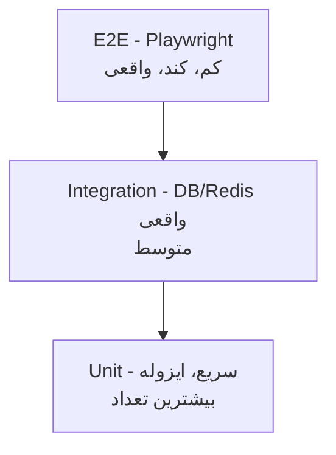

# استراتژی تست

> این سند الزامات تست Unit، Integration، Contract و E2E را تعریف می‌کند. تست بخشی از Definition of Done است و هیچ تسکی بدون تست پذیرفته نمی‌شود.

## 1. اهداف

1. اطمینان از صحت جریان‌های امنیتی OIDC/OAuth 2.1.
2. جلوگیری از Regression در SSO، نقش‌ها، سوشال لاگین و میکرو-فرانت‌اند.
3. پوشش رفتار چند اپلیکیشنی و مرزهای دسترسی (Client Scope).
4. اجرای خودکار در CI با Feedback سریع.
5. قابلیت تکرارپذیری و حذف Flaky Testها.

## 2. هرم تست

| لایه | سهم هدف | ابزار | محیط |
|---|---|---|---|
| Unit | ~60% | Vitest | بدون I/O |
| Integration | ~30% | Vitest + Supertest + Testcontainers | PostgreSQL و Redis واقعی |
| E2E | ~10% | Playwright | اپ کامل + دو Host نمونه |
| Contract | مکمل | OpenAPI Validator + Pact (اختیاری) | CI |
| Security | مکمل | OWASP ZAP + تست‌های منفی | CI/استیجینگ |
| Performance | مکمل | k6 | استیجینگ |

> درصدها راهنما هستند؛ تمرکز اصلی روی پوشش رفتارهای حساس است، نه عدد.

## 3. استک تست

| مورد | انتخاب |
|---|---|
| Unit/Integration Runner | Vitest |
| HTTP Integration | Supertest |
| Database/Redis | Testcontainers (`@testcontainers/postgresql`, `@testcontainers/redis`) |
| Mock سرویس‌های بیرونی | MSW (Node) یا WireMock |
| E2E | Playwright |
| Component Test | React Testing Library + user-event |
| Accessibility | axe-core (`@axe-core/playwright`, `vitest-axe`) |
| Coverage | V8 Coverage |
| Load | k6 |
| Security Scan | `npm audit`, Trivy, OWASP ZAP Baseline |
| Visual Regression | Playwright Screenshot |
| Design System | shadcn/ui + Tokens |
| API Contract | OpenAPI 3.1 + `openapi-diff` + Schemathesis (اختیاری) |
| CI | GitHub Actions |

> تست‌ها باید روی Node.js نسخه LTS و PostgreSQL 16 اجرا شوند. نسخه دقیق در `.nvmrc` و `package.json` پین می‌شود.

## 4. Unit Tests

### 4.1 محدوده

- محاسبه مجوز مؤثر (`resolvePermissions`)
- ساخت و اعتبارسنجی Claimها
- اعتبارسنجی PKCE، Redirect URI و Scope
- چرخش Refresh Token و تشخیص Reuse
- قواعد قفل حساب و Rate Limit (با Clock تزریقی)
- آداپترهای Provider سوشال (تبدیل پروفایل، بررسی ایمیل تأییدشده)
- اعتبارسنجی ورودی‌ها (Zod Schema)
- Utilityهای تاریخ/زمان و انقضا
- کامپوننت‌های MFE و Hookها

### 4.2 قواعد

- بدون Network، DB یا Sleep واقعی.
- زمان با `vi.useFakeTimers` کنترل شود.
- هر تست مستقل و بدون ترتیب وابسته.
- نام‌گذاری: `describe('resolvePermissions')` و `it('returns only client-scoped permissions')`.
- برای منطق حساس امنیتی، تست حالت‌های منفی به‌اندازه حالت مثبت اهمیت دارد.

### 4.3 نمونه موارد الزامی

| ID | تست |
|---|---|
| UNIT-AUTH-001 | Code منقضی رد می‌شود |
| UNIT-AUTH-002 | Code با `redirect_uri` متفاوت رد می‌شود |
| UNIT-AUTH-003 | PKCE اشتباه رد می‌شود |
| UNIT-AUTH-004 | Refresh Token استفاده‌شده کل Family را باطل می‌کند |
| UNIT-RBAC-001 | نقش پلتفرم A مجوز پلتفرم B نمی‌دهد |
| UNIT-RBAC-002 | نقش `idp:*` در توکن کلاینت عادی درج نمی‌شود |
| UNIT-RBAC-003 | تخصیص منقضی در محاسبه نادیده گرفته می‌شود |
| UNIT-RBAC-004 | Delegated Admin فقط Scope کلاینت خود را می‌بیند |
| UNIT-SOCIAL-001 | ایمیل تأییدنشده باعث Auto-link نمی‌شود |
| UNIT-SOCIAL-002 | Provider غیرفعال برای کلاینت رد می‌شود |
| UNIT-MFE-001 | Config نامعتبر باعث Error قابل مشاهده می‌شود |
| UNIT-MFE-002 | رویدادها توکن افشا نمی‌کنند |
| UNIT-LOC-001 | زنجیره تعیین زبان به‌ترتیب درست عمل می‌کند |
| UNIT-LOC-002 | Locale غیرفعال به مرحله بعد سقوط می‌کند |
| UNIT-LOC-003 | متن HTML/Script رد یا Escape می‌شود |
| UNIT-CTX-001 | Context نامعتبر/متعلق به اپ دیگر رد می‌شود |
| UNIT-CTX-002 | نقش خارج از `allowed_roles` در توکن درج نمی‌شود |

## 5. Integration Tests

### 5.1 محیط

- PostgreSQL واقعی با Testcontainers و Migrationهای واقعی.
- Redis واقعی برای Session و Rate Limit.
- سرویس ایمیل Mock.
- سرویس‌های Google/Facebook با MSW/WireMock.
- هر Suite دیتابیس ایزوله یا Transaction Rollback دارد.

### 5.2 محدوده

- `/oauth2/authorize` → `/oauth2/token` → `/userinfo`
- صدور و اعتبارسنجی JWKS
- Refresh Rotation و Reuse Detection
- SSO با کوکی نشست
- RP-Initiated Logout و Back-channel Logout
- CRUD کاربر، کلاینت، نقش و تخصیص
- ClientMembership و Delegated Admin Scope
- ثبت Audit برای عملیات حساس
- Rate Limit و قفل حساب
- سوشال لاگین با Provider Mock و Client Credential اختصاصی
- مهاجرت‌ها (Migration up/down)

### 5.3 نمونه موارد الزامی

| ID | تست |
|---|---|
| INT-OIDC-001 | جریان کامل Code + PKCE موفق |
| INT-OIDC-002 | استفاده مجدد از Code رد و توکن‌ها باطل می‌شود |
| INT-OIDC-003 | `alg=none` و امضای نامعتبر رد می‌شود |
| INT-OIDC-004 | JWKS پس از چرخش کلید هم کلید قدیمی و هم جدید را دارد |
| INT-SSO-001 | ورود در App A و دریافت Code برای App B بدون Login |
| INT-LOGOUT-001 | Back-channel Logout نشست اپ را باطل می‌کند |
| INT-RBAC-001 | ادمین App A نمی‌تواند عضو App B را تغییر دهد |
| INT-RBAC-002 | ادمین App A نمی‌تواند نقش سراسری تخصیص دهد |
| INT-RBAC-003 | Scope `idp.client-admin` برای کاربر غیرادمین صادر نمی‌شود |
| INT-MEMBER-001 | دعوت کاربر و عضویت در App A |
| INT-MEMBER-002 | غیرفعال‌سازی عضویت فقط دسترسی همان App را قطع می‌کند |
| INT-SOCIAL-001 | هر کلاینت از Credential سوشال خودش استفاده می‌کند |
| INT-SOCIAL-002 | Callback با `client_id` اشتباه رد می‌شود |
| INT-LOC-001 | Override متن اپ روی بسته پایه اعمال می‌شود |
| INT-LOC-002 | کلید ناشناخته با `422` رد می‌شود |
| INT-LOC-003 | Bundle با `ETag` و `version` درست Cache می‌شود |
| INT-CTX-001 | توکن فقط نقش‌های `allowed_roles` همان Context را دارد |
| INT-CTX-002 | Refresh Token یک Context برای Context دیگر کار نمی‌کند |
| INT-CTX-003 | ادمین Context به Context دیگر دسترسی ندارد |
| INT-CTX-004 | Context غیرفعال ورود و Refresh را رد می‌کند |
| INT-AUDIT-001 | تغییر نقش و تغییر Provider سوشال Audit می‌شود |

## 6. Contract Tests

1. **OpenAPI:** پاسخ همه Endpointها با Schema تطابق دارد؛ تغییر ناسازگار در CI شکست می‌خورد.
2. **MFE Config/Event:** Schema مشترک بین Host و Remote نسخه‌بندی و تست می‌شود.
3. **Token Claims:** Snapshot ساختار Claimها با تغییر کنترل‌شده.
4. **Social Providers:** آداپتر هر Provider با Fixture پاسخ واقعی (Sanitize‌شده) تست می‌شود.
5. **Back-channel Logout:** ساختار Logout Token مطابق OIDC.

## 7. E2E Tests

### 7.1 سناریوهای اصلی

| ID | سناریو |
|---|---|
| E2E-001 | ثبت‌نام/دعوت → ورود → مشاهده پروفایل |
| E2E-002 | ورود در App A → باز کردن App B بدون صفحه ورود (SSO) |
| E2E-003 | خروج سراسری از App A → App B خارج می‌شود |
| E2E-004 | تخصیص نقش در پنل → دسترسی در اپ اعمال می‌شود |
| E2E-005 | ادمین App A فقط اعضای App A را می‌بیند |
| E2E-006 | سوشال لاگین Google با Mock Provider برای App A |
| E2E-007 | سوشال لاگین Facebook با Credential جدا برای App B |
| E2E-008 | MFA اجباری ادمین و Step-up برای تغییر نقش |
| E2E-009 | Refresh خودکار پس از انقضای Access Token |
| E2E-010 | Fallback به صفحه Hosted وقتی Remote بارگذاری نمی‌شود |
| E2E-011 | Mount/Unmount میکرو-فرانت در Host بدون خطا |
| E2E-012 | Web Component در یک Host غیر-React |
| E2E-013 | عدم نشت CSS/Preflight از MFE به Host با Tailwind مستقل |
| E2E-014 | RTL فارسی و Visual Regression در Light/Dark |
| E2E-015 | Portalهای Radix (Dialog/Select) داخل ریشه MFE/Shadow DOM |
| E2E-016 | ورود از دو Context مختلف یک اپ با نقش‌های متفاوت |
| E2E-017 | تغییر زبان و RTL بدون Reload و با حفظ State |
| E2E-018 | متن اختصاصی اپ در صفحه ورود نمایش داده می‌شود |
| E2E-019 | BFF نمونه: ورود با PKCE، نگه‌داری توکن سمت سرور، Refresh و خروج (`e2e/bff/`) |
| E2E-020 | BFF: State متصل به مرورگر و Callback جعلی رد می‌شود (`invalid_state`) |
| E2E-021 | SSO و خروج بین دو کلاینت روی یک BFF (`e2e/bff/sso-logout.spec.ts`) |

### 7.2 قواعد

- هر تست داده مخصوص خود می‌سازد (Factory) و به داده تست دیگر وابسته نیست.
- انتخابگرها با `data-testid` پایدار.
- Retry حداکثر 1 بار و فقط برای Flaky موقت؛ تست Flaky باید Quarantine و رفع شود.
- Screenshot/Trace در شکست ذخیره می‌شود.
- اجرا روی Chromium در PR و Firefox/WebKit در Nightly.
- تست RTL و Locale فارسی در یکی از سناریوها.

## 8. تست میکرو-فرانت‌اند

| نوع | ابزار | نمونه |
|---|---|---|
| Component | Vitest + RTL | فرم ورود، خطاها، Loading |
| Host Mount | Playwright Component Testing یا Fixture App | Mount با `clientId`های مختلف |
| Contract | Zod Schema | Config/Event نسخه قدیمی و جدید |
| Isolation | Visual/Computed Style | عدم نشت CSS به Host |
| Web Component | Playwright + HTML Fixture | `<on4net-auth>` در Vue/Angular |
| Fallback | Playwright Route Interception | مسدودکردن Remote و انتظار Redirect |
| A11y | axe-core | فرم‌ها و جدول کاربران؛ گیت Critical/Serious با `pnpm test:a11y` |
| shadcn/ui | Vitest + RTL + Playwright | Button/Input/Form/Dialog/Select/Table |
| RTL | Playwright Screenshot | fa-IR، ترکیب فارسی/انگلیسی |
| Visual | Playwright Screenshot | Light/Dark و RTL/LTR با `pnpm test:visual` (Baseline به‌ازای Platform در `e2e/visual/__screenshots__/<platform>/`) |
| Version | Matrix | دو نسخه Host در برابر دو نسخه Remote |

## 9. تست امنیتی

- تست‌های منفی در Integration:
  - حذف PKCE
  - `redirect_uri` نادرست
  - `state` تکراری/نامعتبر
  - `alg=none`
  - Refresh Reuse
  - CSRF روی فرم‌های Cookie-based
  - Rate Limit
  - دسترسی Cross-Client
  - تخصیص نقش بالاتر از سطح مجاز
  - Callback سوشال با `client_id` یا `state` نادرست
- OWASP ZAP Baseline روی محیط استیجینگ در هر Release.
- `npm audit` و Trivy در CI.
- بررسی عدم وجود Secret/Token در لاگ با تست Log Redaction.
- تست CSP و هدرهای امنیتی.

## 10. تست کارایی

| سناریو | هدف |
|---|---|
| Login (رمز) | p95 < 800ms |
| `/token` | p95 < 300ms |
| JWKS | p95 < 50ms (Cache) |
| 50 Login/s به‌مدت 10 دقیقه | بدون خطا و بدون افزایش حافظه |
| Refresh Storm | رفتار صحیح Rate Limit |

- آستانه‌ها در CI شکست می‌دهند (مرحله Nightly/Release).
- نتایج در داشبورد ذخیره می‌شود.

## 11. پوشش (Coverage)

| محدوده | حداقل |
|---|---|
| `auth` و `security` core | 90% خط |
| سرویس‌های RBAC/Membership | 85% خط |
| کنترلرها و DTOها | 70% خط |
| MFE Components | 70% خط |
| shadcn/ui Components | 70% خط |
| کل پروژه | 80% خط |

- Coverage پایین‌تر از حد فقط با تأیید صریح و ثبت دلیل مجاز است.
- Coverage تنها معیار نیست؛ تست رفتارهای حساس الزامی است.

## 12. CI/CD

| مرحله | Trigger | محتوا |
|---|---|---|
| Lint + Typecheck | هر PR | ESLint، `tsc --noEmit` |
| Unit | هر PR | Vitest با Coverage |
| Integration | هر PR | Testcontainers (Postgres/Redis) |
| Contract | هر PR | OpenAPI diff + Schema |
| E2E Smoke | هر PR | همه پروژه‌های Playwright روی Chromium: API، Hosted UI، MFE (Isolation، Web Component، Module Federation) و BFF |
| UI Accessibility | هر PR | `pnpm test:a11y` — axe Critical/Serious روی همه سطوح shadcn، بدون نیاز به دیتابیس |
| UI Visual | هر PR | `pnpm test:visual` روی `windows-latest` با Baselineهای `win32` |
| E2E Full | Main/Nightly | همه سناریوها + Firefox/WebKit |
| Security | Nightly/Release | Audit، Trivy، ZAP Baseline |
| Load | Release | k6 |

**قواعد Merge:**

- CI سبز الزامی است.
- کاهش Coverage بیش از 1% نیازمند تأیید است.
- هیچ تست Flaky در Main مجاز نیست.

## 13. داده تست

- Factory برای User، Client، Role، Membership، SocialProvider.
- داده‌های حساس واقعی استفاده نمی‌شود.
- Seedهای توسعه از Seedهای تست جدا هستند.
- پاکسازی خودکار پس از هر Suite.
- Screenshot/Trace حاوی داده حساس نباشد.

## 14. نگاشت الزامات به تست

| الزام | تست‌ها |
|---|---|
| SSO | INT-SSO-001، E2E-002 |
| خروج سراسری | INT-LOGOUT-001، E2E-003 |
| RBAC چنداپلیکیشنی | UNIT-RBAC-001..004، INT-RBAC-001..003، E2E-004 |
| مدیریت کاربری هر اپ | INT-MEMBER-001..002، E2E-005 |
| سوشال با کلید هر اپ | UNIT-SOCIAL-001..002، INT-SOCIAL-001..002، E2E-006..007 |
| میکرو-فرانت‌اند مشترک | UNIT-MFE-001..002، E2E-010..012 |
| shadcn/ui و ایزولاسیون | E2E-013..015، Visual/A11y |
| چندزبانه per-app | UNIT-LOC-001..003، INT-LOC-001..003، E2E-017..018 |
| چند مدل ورود per-app | UNIT-CTX-001..002، INT-CTX-001..004، E2E-016 |
| امنیت توکن | UNIT-AUTH-001..004، INT-OIDC-001..004 |
| MFA و Step-up | E2E-008 |

## 15. Definition of Done تست

- [ ] تست Unit برای منطق جدید نوشته شده است.
- [ ] تست Integration برای Endpoint/سرویس جدید یا تغییر رفتار نوشته شده است.
- [ ] در صورت تغییر UI یا جریان کاربر، تست E2E مرتبط به‌روزرسانی شده است.
- [ ] قرارداد OpenAPI و MFE به‌روزرسانی و تست شده است.
- [ ] حالت‌های منفی امنیتی پوشش داده شده‌اند.
- [ ] تست‌ها در CI سبز هستند و Flaky نیستند.
- [ ] Coverage حداقل‌های تعیین‌شده را رعایت می‌کند.
